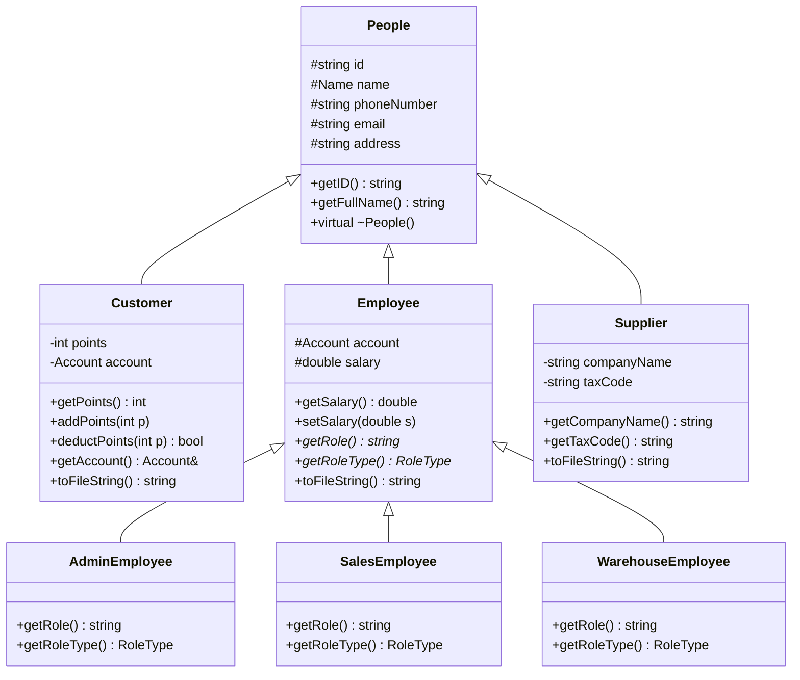
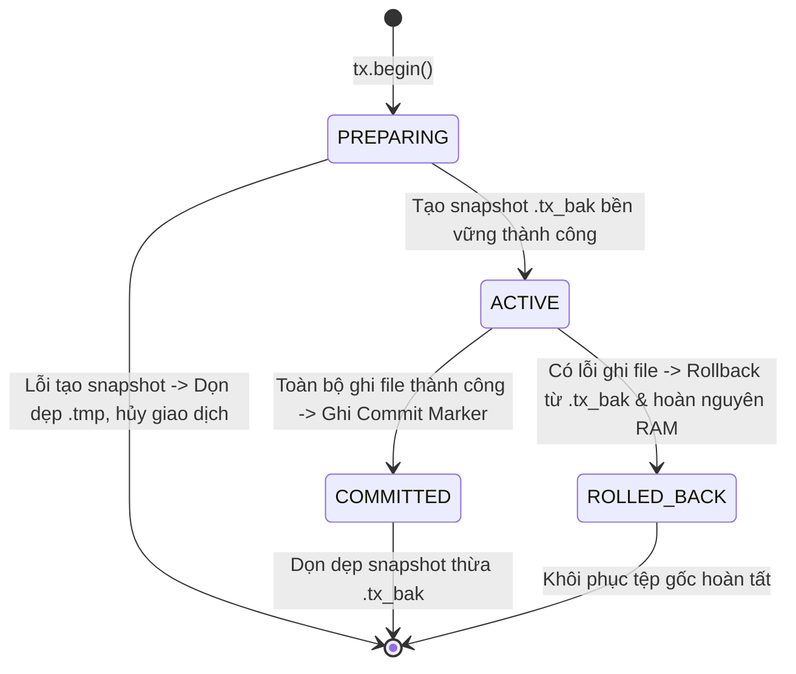

# TỔNG QUAN TOÀN BỘ KIẾN TRÚC VÀ MÃ NGUỒN DỰ ÁN PBL2
# HỆ THỐNG QUẢN LÝ CỬA HÀNG ĐIỆN THOẠI (PHONE STORE MANAGEMENT SYSTEM)

> **Tài liệu kỹ thuật tổng hợp toàn diện dự án PBL2**  
> **Ngôn ngữ:** C++ (Chuẩn C++17 `-std=c++17`)  
> **Giao diện người dùng:** GTK4 (C API), Pango Text Layout, Cairo Vector 2D Graphics, Fontconfig  
> **Hệ thống lưu trữ:** Hệ thống tệp văn bản phẳng thuần UTF-8 (`.txt`)  
> **Bảo mật & Mật mã:** OpenSSL (`libcrypto`) PBKDF2-HMAC-SHA256 (600.000 vòng lặp, salt 16-byte ngẫu nhiên)  
> **Kiến trúc phần mềm:** Kiến trúc phân tầng 6 lớp (6-Layer Architecture) kết hợp Lập trình Hướng đối tượng (OOP) và Cấu trúc Dữ liệu Giải thuật tự cài đặt (Custom Data Structures & Algorithms)  
> **Ngày lập tài liệu:** 12/11/2026  

---

## 1. TỔNG QUAN

### 1.1. Mục tiêu hệ thống
Dự án PBL2 "Hệ thống quản lý cửa hàng điện thoại" là giải pháp phần mềm máy tính (Desktop Application) hoàn chỉnh, phục vụ tin học hóa toàn diện quy trình kinh doanh của một chuỗi bán lẻ điện thoại thông minh. Hệ thống hỗ trợ đồng thời hai kênh bán hàng:
1. **Bán hàng trực tiếp tại quầy (POS - Point of Sale):** Tra cứu danh mục, kiểm tra tồn kho khả dụng tức thời, áp dụng mã voucher khuyến mãi, quét thẻ thành viên tích điểm, nhận tiền mặt từ khách, tính tiền thối tự động và in/xuất hóa đơn bán lẻ.
2. **Kênh thương mại điện tử trực tuyến (Online Ordering):** Cho phép khách hàng duyệt xem thông số kỹ thuật chi tiết nhiều dòng, lựa chọn linh hoạt tổ hợp biến thể (Màu sắc, Dung lượng bộ nhớ), quản lý giỏ hàng cá nhân, đặt hàng trực tuyến với cơ chế giữ chỗ tồn kho và theo dõi tiến độ đơn hàng.

Bên cạnh đó, hệ thống tích hợp phân hệ quản trị kho hàng (nhập hàng từ đối tác nhà cung cấp, cảnh báo tồn thấp, quản lý giá vốn và điều phối đóng gói xuất kho), phân hệ tiếp nhận và giải quyết bảo hành phần cứng theo mã IMEI/đơn hàng, phân hệ quản lý tài chính - báo cáo thống kê doanh thu và lợi nhuận gộp, cùng phân hệ đồng hồ mô phỏng thời gian thực phục vụ đối soát nghiệp vụ có thời hạn.

Hệ thống được thiết kế đặc thù theo yêu cầu đồ án: **Không sử dụng bất kỳ Hệ quản trị cơ sở dữ liệu (DBMS) nào**, toàn bộ dữ liệu nghiệp vụ được tổ chức trên các tệp tin văn bản thuần `.txt` mã hóa UTF-8; đồng thời **tự cài đặt toàn bộ các cấu trúc dữ liệu cơ sở** (Vector, HashTable, BST, LinkedList, Queue, Stack) để lưu trữ trên bộ nhớ RAM và đánh chỉ mục nghiệp vụ mà không phụ thuộc vào container của thư viện chuẩn STL cho tầng dữ liệu chính.

### 1.2. Các vai trò người dùng (User Roles) và Ma trận phân quyền
Hệ thống quản lý định danh và phân quyền chặt chẽ theo 4 vai trò thông qua `enum class RoleType` trong [`source/models/Common.h:45-50`](file:///c:/DUY/PBL2/source/models/Common.h#L45-L50):

```cpp
enum class RoleType {
    ADMIN,              // Quản trị viên hệ thống
    SALE_EMPLOYEE,       // Nhân viên Bán hàng
    WAREHOUSE_EMPLOYEE,  // Nhân viên Kho (Thủ kho)
    CUSTOMER            // Khách hàng
};
```

Bên cạnh đó, quyền hạn thao tác chức năng được chuẩn hóa qua `enum class Permission` trong [`source/models/Common.h:64-80`](file:///c:/DUY/PBL2/source/models/Common.h#L64-L80):

```cpp
enum class Permission {
    PRODUCT_VIEW, PRODUCT_CREATE, PRODUCT_UPDATE, PRODUCT_DELETE,
    ORDER_VIEW, ORDER_CREATE,
    INVOICE_CREATE,
    STOCK_VIEW, STOCK_UPDATE,
    EMPLOYEE_VIEW, EMPLOYEE_CREATE
};
```

| Vai trò | Mã Enum | Mã lưu tệp | Phạm vi quyền hạn và Trách nhiệm nghiệp vụ cụ thể |
|---|---|:---:|---|
| **Quản trị viên (Admin)** | `RoleType::ADMIN` | `1` | Toàn quyền kiểm soát và vận hành hệ thống:<br>• CRUD danh mục sản phẩm, cập nhật thông số, hình ảnh, bài viết mô tả, giá nhập, giá bán.<br>• Quản lý nhân sự: Xem danh sách nhân viên, thêm mới, sửa thông tin, phân ngạch lương cơ bản (`salary`), xóa nhân viên.<br>• Quản lý tài khoản: Kích hoạt/khóa tài khoản (`toggleAccountStatus`), thay đổi vai trò tài khoản (`changeAccountRole`).<br>• Quản trị khuyến mãi: Thiết lập mã voucher (`DiscountCode`), hạn mức giảm, ngày hiệu lực.<br>• Quản lý đối tác cung ứng (`Suppliers`) và xem toàn bộ lịch sử hóa đơn, đơn hàng.<br>• Xem báo cáo phân tích kinh doanh: Doanh thu thực tế, tổng giá vốn hàng bán, lợi nhuận gộp ước tính, biểu đồ cột Cairo theo ngày/tháng/năm, biểu đồ tròn cơ cấu hãng và Top 5 máy bán chạy.<br>• Điều khiển phân hệ Đồng hồ mô phỏng thời gian thực (`admin_realtime`). |
| **Nhân viên Bán hàng (Sales)** | `RoleType::SALE_EMPLOYEE` | `2` | Phục vụ khách hàng và vận hành giao dịch bán lẻ:<br>• Thao tác màn hình POS: Lựa chọn sản phẩm, tính tiền, áp mã voucher, nhận tiền khách đưa, tính tiền thừa và xuất hóa đơn bán lẻ.<br>• Tra cứu danh mục sản phẩm, thông số cấu hình và kiểm tra số lượng tồn kho khả dụng.<br>• Quản lý hồ sơ khách hàng: Tra cứu khách hàng theo tên/SĐT/mã, thêm khách hàng mới, cập nhật địa chỉ/SĐT.<br>• Xử lý đơn hàng trực tuyến: Xem danh sách đơn, xuất hóa đơn bán lẻ cho các đơn hàng online.<br>• Tiếp nhận bảo hành: Tạo phiếu yêu cầu bảo hành cho khách hàng mang máy đến quầy, cập nhật tiến độ xử lý.<br>• **Bị giới hạn:** Không được xem mức lương nhân viên, không được xem báo cáo tài chính/lợi nhuận admin, không được cấu hình mã giảm giá, không được xóa sản phẩm. |
| **Nhân viên Kho (Warehouse)** | `RoleType::WAREHOUSE_EMPLOYEE` | `3` | Quản lý kho hàng và điều phối chuỗi cung ứng:<br>• Theo dõi danh mục tồn kho thực tế, tồn kho giữ chỗ và tồn kho khả dụng.<br>• Theo dõi danh sách các mặt hàng chạm ngưỡng tồn thấp (`actualStock <= 5`) để kịp thời lập kế hoạch nhập hàng.<br>• Lập phiếu nhập kho hàng (`createGoodsReceipt`) từ đối tác cung cấp, cập nhật giá nhập và tự động tăng số lượng tồn kho.<br>• Điều phối đóng gói và xuất kho cho các đơn hàng trực tuyến (`PREPARING` $\rightarrow$ `READY_FOR_PICKUP` $\rightarrow$ `SHIPPING`).<br>• **Bị giới hạn:** Bị chặn hoàn toàn quyền truy cập vào module bảo hành (cả trên GUI và Controller), không được xem thông tin khách hàng, tiền lương, doanh thu hay hóa đơn bán lẻ. |
| **Khách hàng (Customer)** | `RoleType::CUSTOMER` | `N/A` | Người mua sắm và sử dụng dịch vụ:<br>• Đăng ký tài khoản mới, đăng nhập, quản lý thông tin cá nhân và đổi mật khẩu.<br>• Xem danh mục điện thoại, tìm kiếm theo từ khóa tiếng Việt không dấu/có dấu, lọc theo khoảng giá và hãng sản xuất.<br>• Xem chi tiết sản phẩm: Ảnh thực tế, cấu hình chi tiết, chọn màu sắc và dung lượng bộ nhớ.<br>• Quản lý giỏ hàng: Thêm máy vào giỏ, cập nhật số lượng, tick chọn các sản phẩm muốn thanh toán.<br>• Đặt hàng trực tuyến (Checkout): Áp mã voucher, chọn hình thức giao hàng tận nơi hoặc lấy tại shop, chọn phương thức thanh toán.<br>• Theo dõi tiến độ đơn hàng cá nhân, hủy đơn hàng khi đơn còn ở trạng thái `PENDING`.<br>• Xem tích lũy điểm thưởng thành viên và hạng thẻ (Đồng, Bạc, Vàng, Bạch Kim).<br>• Gửi yêu cầu bảo hành đối với các thiết bị đã mua trong các đơn hàng hoàn tất (`COMPLETED`).<br>• Đánh giá và viết nhận xét sản phẩm (chỉ dành cho khách hàng đã mua và hoàn thành đơn). |

### 1.3. Công nghệ và môi trường thực thi
- **Ngôn ngữ lập trình:** C++
- **Tiêu chuẩn ngôn ngữ:** C++17 (`-std=c++17`), sử dụng các tính năng hiện đại như `std::filesystem`, cấu trúc structured binding, `std::string_view`, move semantics và con trỏ thông minh.
- **Thư viện Giao diện đồ họa (GUI):** GTK4 (phiên bản C API, `gtk4 >= 4.0.0`), tích hợp engine vẽ đồ họa vector 2D Cairo (vẽ biểu đồ cột doanh thu và biểu đồ phân bổ cơ cấu hãng) và thư viện dàn trang văn bản Pango.
- **Xử lý phông chữ và biểu tượng:** Fontconfig (`fontconfig`), thư viện phông màu Unicode Emoji `NotoColorEmoji.ttf` đặt tại `UI/styles/NotoColorEmoji.ttf` nạp qua Win32 API `AddFontResourceExA` hoặc Fontconfig `FcConfigAppFontAddFile`.
- **Mã hóa & An toàn thông tin:** OpenSSL `libcrypto` (`openssl/evp.h`, `openssl/rand.h`), sử dụng chuẩn công nghiệp PBKDF2-HMAC-SHA256 với 600.000 vòng lặp và salt ngẫu nhiên 16 byte để bảo vệ mật khẩu.
- **Hệ điều hành đang chạy:** Windows 10/11 (biên dịch bằng MSYS2 môi trường UCRT64 với bộ công cụ MinGW-w64 GCC).
- **Hệ điều hành tương thích:** Linux (Ubuntu 22.04+, Fedora 38+) thông qua Makefile tiêu chuẩn sử dụng `pkg-config`.
- **Công cụ xây dựng (Build Tool):** GNU Make (`Makefile`).

---

## 2. CẤU TRÚC THƯ MỤC

```text
c:\DUY\PBL2\
├── main.cpp                       # Điểm khởi nhập (entry point) của ứng dụng, khởi tạo kho và chạy GTK4
├── Makefile                       # Tệp chỉ thị biên dịch GNU Make cho toàn bộ hệ thống
├── README.md                      # Tài liệu giới thiệu tổng quan dự án
├── CHANGELOG.md                   # Nhật ký ghi nhận các thay đổi và bản vá lỗi qua các giai đoạn
├── ANTI.md                        # Báo cáo phân tích hiện trạng các lỗi kiến trúc, bảo mật và lưu trữ
├── PROJECT_OVERVIEW.md            # [TÀI LIỆU NÀY] Đặc tả toàn diện kiến trúc và mã nguồn phục vụ viết báo cáo
├── data/                          # Thư mục gốc chứa toàn bộ các tệp dữ liệu văn bản UTF-8
│   ├── DATA_FORMAT_GUIDE.md       # Cẩm nang quy chuẩn đặc tả schema và định dạng dữ liệu
│   ├── introduction.txt           # Tệp văn bản giới thiệu dữ liệu tổng quan
│   ├── realTime.txt               # Lưu trữ mốc ngày giờ giả lập hiện hành của hệ thống
│   ├── Device/                    # Phân hệ lưu trữ dữ liệu thiết bị, sản phẩm và kho hàng
│   │   ├── Products.txt           # Danh mục chính sản phẩm điện thoại (9 cột)
│   │   ├── Thongsokythuat.txt     # Chi tiết thông số kỹ thuật nhiều dòng của từng sản phẩm
│   │   ├── ProductDescriptions.txt# Điểm nổi bật (highlights) và bài viết mô tả chi tiết máy
│   │   ├── ProductImage.txt       # Bảng ánh xạ danh sách đường dẫn ảnh của từng sản phẩm
│   │   ├── ProductMarketing.txt   # Dữ liệu tiếp thị: giá niêm yết, thời hạn sale, trả góp, màu sắc
│   │   ├── ProductReviews.txt     # Đánh giá sao (1-5) và bình luận của khách hàng sau khi mua
│   │   ├── StockReceipts.txt      # Lịch sử các phiếu nhập kho hàng từ nhà cung cấp
│   │   ├── SupplierProducts.txt   # Danh sách liên kết nhà cung cấp cung ứng mặt hàng điện thoại nào
│   │   └── productImages/         # Thư mục chứa các tệp ảnh PNG minh họa thực tế của sản phẩm
│   ├── PAY/                       # Phân hệ thanh toán, giảm giá, hóa đơn và đơn đặt hàng
│   │   ├── Discount.txt           # Danh mục mã khuyến mãi / voucher giảm giá (9 cột)
│   │   ├── Invoices.txt           # Danh mục hóa đơn bán hàng đã xuất (8 cột)
│   │   ├── WarrantyRequests.txt   # Danh mục phiếu yêu cầu bảo hành đang hoạt động của hệ thống (11 cột)
│   │   └── Order/                 # Thư mục phụ trách đơn hàng trực tuyến
│   │       ├── Orders.txt         # Danh mục đơn đặt hàng của khách hàng (11 cột)
│   │       └── introduction.txt   # Ghi chú định dạng dữ liệu đơn hàng
│   ├── people/                    # Phân hệ thực thể con người (khách hàng, nhân viên, nhà cung cấp)
│   │   ├── Customers.txt          # Danh sách khách hàng và tài khoản khách hàng
│   │   ├── Employee.txt           # Danh sách nhân viên (Admin, Sales, Warehouse) và tài khoản
│   │   ├── Suppliers.txt          # Danh sách đối tác nhà cung cấp thiết bị
│   │   └── introduction.txt       # Ghi chú dữ liệu phân hệ con người
│   ├── system/                    # Cấu hình hệ thống và bộ đếm mã tự tăng
│   │   ├── id_counters.txt        # Lưu trữ trạng thái bộ đếm sinh mã tự tăng cho mọi thực thể
│   │   └── StoreSettings.txt      # Chính sách vận chuyển, bảo hành và đổi trả toàn cửa hàng
│   └── warranty/                  # Phân hệ bảo hành phần cứng
│       ├── Warranties.txt         # Hồ sơ bảo hành gốc theo IMEI thiết bị (9 cột)
│       └── WarrantyRequests.txt   # Bản sao lưu/khởi thủy yêu cầu bảo hành (schema 10 cột)
├── source/                        # Mã nguồn tầng Cốt lõi, Mô hình, Lưu trữ, Dịch vụ và Điều phối
│   ├── PBL2.h                     # Tệp tiêu đề tổng hợp bao gói toàn bộ core, models, repos, services
│   ├── CTDL.cpp                   # Mã nguồn nguyên mẫu (prototype) sơ khai của cấu trúc dữ liệu
│   ├── task.txt                   # Ghi chú danh sách công việc nội bộ
│   ├── core/                      # CẤU TRÚC DỮ LIỆU TỰ XÂY DỰNG (CUSTOM DATA STRUCTURES)
│   │   ├── Vector.h               # Mảng động tự co giãn Vector<T>, quản lý bộ nhớ Rule of 5
│   │   ├── HashTable.h            # Bảng băm HashTable<K, V> băm chuỗi DJB2, Separate Chaining
│   │   ├── BST.h                  # Cây tìm kiếm nhị phân BST<Key, Value>, range search
│   │   ├── LinkedList.h           # Danh sách liên kết đôi LinkedList<T>, quản lý hai đầu head/tail
│   │   ├── Queue.h                # Hàng đợi FIFO Queue<T> xây dựng trên nền LinkedList<T>
│   │   └── Stack.h                # Ngăn xếp LIFO Stack<T> xây dựng trên nền Vector<T>
│   ├── models/                    # CÁC LỚP MÔ HÌNH THỰC THỂ (OOP DOMAIN ENTITIES)
│   │   ├── Common.h               # Struct Name, các enum (RoleType, OrderStatus, DeliveryMethod...)
│   │   ├── People.h               # Lớp cơ sở trừu tượng hóa con người (id, name, phone, email, address)
│   │   ├── Account.h              # Lớp tài khoản người dùng, băm mật khẩu PBKDF2 và phân quyền Role
│   │   ├── Customer.h             # Lớp khách hàng (kế thừa People), quản lý điểm tích lũy và Account
│   │   ├── Employee.h             # Lớp trừu tượng nhân viên (kế thừa People), đa hình 3 vai trò
│   │   ├── Supplier.h             # Lớp nhà cung cấp (kế thừa People), mã số thuế và tên công ty
│   │   ├── Phone.h                # Lớp sản phẩm điện thoại di động, tồn kho và đơn giá
│   │   ├── Cart.h                 # Lớp giỏ hàng (Cart) và chi tiết mục hàng trong giỏ (CartItem)
│   │   ├── Order.h                # Lớp đơn hàng (Order), chi tiết OrderDetail và thông tin giao nhận
│   │   ├── Invoice.h              # Lớp hóa đơn bán hàng (Invoice), ghi nhận thanh toán và chi tiết máy
│   │   ├── ImportReceipt.h        # Lớp phiếu nhập kho hàng (ImportReceipt) từ nhà cung cấp
│   │   ├── DiscountCode.h         # Lớp mã voucher giảm giá, kiểm tra hạn dùng và giá trị giảm
│   │   ├── Warranty.h             # Lớp hồ sơ bảo hành theo máy và IMEI
│   │   └── WarrantyRequest.h      # Lớp yêu cầu tiếp nhận bảo hành từ khách hàng
│   ├── repositories/              # TẦNG TRUY XUẤT TỆP DỮ LIỆU (DATA REPOSITORIES)
│   │   ├── AccountRepository.h    # Quản lý nạp/lưu tài khoản độc lập
│   │   ├── PhoneRepository.h      # Đọc/ghi tệp Products.txt và Thongsokythuat.txt
│   │   ├── ProductDescriptionRepository.h # Đọc/ghi tệp ProductDescriptions.txt
│   │   ├── ProductImageRepository.h       # Đọc/ghi tệp ProductImage.txt
│   │   ├── ProductMarketingRepository.h   # Đọc/ghi tệp ProductMarketing.txt
│   │   ├── CustomerRepository.h   # Đọc/ghi tệp Customers.txt
│   │   ├── EmployeeRepository.h   # Đọc/ghi tệp Employee.txt
│   │   ├── SupplierRepository.h   # Đọc/ghi tệp Suppliers.txt
│   │   ├── DiscountRepository.h   # Đọc/ghi tệp Discount.txt
│   │   ├── OrderRepository.h      # Đọc/ghi tệp Orders.txt
│   │   ├── InvoiceRepository.h    # Đọc/ghi tệp Invoices.txt
│   │   ├── StockReceiptRepository.h       # Đọc/ghi tệp StockReceipts.txt
│   │   ├── stockReceiptRepo.h     # Bản tương thích cũ của StockReceiptRepository
│   │   ├── StoreSettingsRepository.h      # Đọc/ghi tệp StoreSettings.txt
│   │   ├── WarrantyRepository.h   # Đọc/ghi tệp Warranties.txt
│   │   └── WarrantyRequestRepository.h    # Đọc/ghi tệp WarrantyRequests.txt (tại data/PAY/)
│   ├── services/                  # TẦNG DỊCH VỤ NGHIỆP VỤ CỐT LÕI (BUSINESS SERVICES)
│   │   ├── AuthService.h          # Xác thực tài khoản nhân viên và khách hàng
│   │   ├── CustomerService.h      # Nghiệp vụ khách hàng, tích lũy điểm và thăng hạng thành viên
│   │   ├── EmployeeService.h      # Nghiệp vụ nhân viên, quản lý tài khoản và tiền lương
│   │   ├── PhoneService.h         # Nghiệp vụ sản phẩm, vận hành HashTable O(1) và BST O(log N)
│   │   ├── OrderService.h         # Nghiệp vụ đơn hàng, chuyển trạng thái và quản lý tồn kho giữ chỗ
│   │   ├── InvoiceService.h       # Nghiệp vụ lập hóa đơn thanh toán cho đơn hàng
│   │   ├── SupplierService.h      # Nghiệp vụ nhà cung cấp và nhập kho hàng hóa
│   │   ├── DiscountService.h      # Nghiệp vụ kiểm tra và áp dụng mã voucher
│   │   ├── ReportService.h        # Nghiệp vụ tổng hợp doanh thu, lợi nhuận gộp và sản phẩm bán chạy
│   │   ├── WarrantyService.h      # Nghiệp vụ tính hạn bảo hành và luân chuyển trạng thái bảo hành
│   │   ├── Check.h                # Bộ kiểm tra ràng buộc toàn vẹn tham chiếu (ReferenceChecker)
│   │   ├── ErrorMessage.h         # Định nghĩa các mã lỗi trả về của dịch vụ sản phẩm
│   │   ├── CardService.h          # Tệp tiêu đề đánh dấu nghiệp vụ thẻ (stub giữ chỗ)
│   │   └── InventoryService.h     # Tệp tiêu đề đánh dấu nghiệp vụ kho (stub giữ chỗ)
│   ├── controllers/               # TẦNG ĐIỀU PHỐI HỆ THỐNG (APPLICATION CONTROLLER)
│   │   ├── AppController.h        # Khai báo lớp AppController điều phối chính toàn bộ hoạt động
│   │   ├── AppControllerSupport.h # Macro phân quyền RBAC, hàm chuyển đổi Model <-> ViewModel
│   │   ├── AppController.cpp      # Quản lý vòng đời Controller, nạp dữ liệu, đồng hồ mô phỏng, session
│   │   ├── AccountController.cpp  # Đổi quyền, khóa tài khoản, bảo hành từ phía tài khoản
│   │   ├── ProductController.cpp  # Quản lý danh mục, thêm/sửa/xóa sản phẩm, đánh giá sao
│   │   ├── CartController.cpp     # Thao tác giỏ hàng, áp voucher, checkout đơn hàng trực tuyến
│   │   ├── OrderController.cpp    # Quản lý đơn hàng, lọc đơn, hoàn tất đơn tự động, hủy đơn
│   │   ├── InvoiceController.cpp  # Bán hàng tại quầy POS, xuất hóa đơn, tính tiền thối
│   │   ├── CustomerController.cpp # Tra cứu, thêm, sửa, xóa hồ sơ khách hàng
│   │   ├── EmployeeController.cpp # Tra cứu, thêm, sửa, xóa hồ sơ và tài khoản nhân sự
│   │   ├── InventoryController.cpp# Quản lý nhà cung cấp, lập phiếu nhập kho, theo dõi tồn kho
│   │   ├── DiscountController.cpp # Thêm, sửa, xóa mã voucher khuyến mãi
│   │   └── ReportController.cpp   # Thống kê số liệu dashboard, tính doanh thu và lợi nhuận gộp
│   └── utils/                     # THƯ VIỆN TIỆN ÍCH BỔ TRỢ HỆ THỐNG
│       ├── DateTime.h             # Lớp thời gian thực, cộng tháng, tính ngày lịch Gregory
│       ├── FileHelper.h           # Tiện ích ghi file nguyên tử (.tmp -> MoveFileExA) và flush đĩa
│       ├── IdGenerator.h          # Bộ sinh mã ID định dạng tự tăng lưu tại id_counters.txt
│       ├── PasswordHasher.h       # Bộ băm mật khẩu chuẩn OpenSSL PBKDF2-HMAC-SHA256
│       ├── PathHelper.h           # Chuẩn hóa đường dẫn tương đối/tuyệt đối trên Windows và POSIX
│       ├── ReviewManager.h        # Đọc và lưu trữ bình luận đánh giá máy vào ProductReviews.txt
│       ├── StringHelper.h         # Cắt chuỗi, định dạng tiền tệ VND, phân tích giá
│       ├── TransactionCoordinator.h# Điều phối giao dịch đa tệp FileTransaction và Crash Recovery
│       └── Utf8Helper.h           # Tìm kiếm substring không phân biệt hoa thường tiếng Việt UTF-8
├── UI/                            # TẦNG GIAO DIỆN NGƯỜI DÙNG GTK4
│   ├── AppRunner.h / .cpp         # Điểm đấu nối vòng đời GtkApplication với GTK4 Main Loop
│   ├── FontSetup.h / .cpp         # Cài đặt phông chữ hệ thống và phông NotoColorEmoji
│   ├── components/                # CÁC THÀNH PHẦN GIAO DIỆN TÁI SỬ DỤNG
│   │   ├── UIComponents.h / .cpp  # Thẻ thống kê, bảng dữ liệu, form nhập liệu, dialog, cairo charts
│   │   └── ProductDetailView.h / .cpp # Hộp thoại chi tiết sản phẩm toàn diện (ảnh, cấu hình, biến thể)
│   ├── screens/                   # CÁC MÀN HÌNH NGHIỆP VỤ THEO VAI TRÒ
│   │   ├── LoginScreen.h / .cpp   # Màn hình đăng nhập, đăng ký tài khoản và quên mật khẩu
│   │   ├── MainShellWindow.h / .cpp # Khung làm việc chính, HeaderBar, Sidebar điều hướng theo Role
│   │   ├── CustomerScreens.h / .cpp # Phân hệ màn hình Khách hàng (Tổng quan, Mua sắm, Giỏ hàng, Đơn...)
│   │   ├── SalesScreens.h / .cpp  # Phân hệ màn hình Bán hàng (POS, Tra cứu máy, Khách hàng, Hóa đơn...)
│   │   ├── WarehouseScreens.h / .cpp # Phân hệ màn hình Thủ kho (Tồn kho, Cảnh báo, Nhập hàng, Đóng gói)
│   │   └── AdminScreens.h / .cpp  # Phân hệ màn hình Quản trị viên (Báo cáo, Quản lý toàn diện, Giả lập)
│   ├── viewmodels/                # CÁC ĐỐI TƯỢNG VIEWMODEL & DTO GIAO DIỆN
│   │   ├── AccountViewModel.h     # DTO hiển thị danh sách tài khoản người dùng
│   │   ├── AuthViewModels.h       # DTO phiên đăng nhập UserSessionViewModel, LoginRequest, LoginResponse
│   │   ├── CartViewModel.h        # DTO giỏ hàng CartSummaryViewModel và CartItemViewModel
│   │   ├── CustomerViewModel.h    # DTO hiển thị và form nhập khách hàng
│   │   ├── DiscountViewModel.h    # DTO hiển thị và form nhập mã giảm giá
│   │   ├── EmployeeViewModel.h    # DTO hiển thị và form nhập nhân sự
│   │   ├── GoodsReceiptViewModel.h# DTO hiển thị và form lập phiếu nhập hàng
│   │   ├── InvoiceViewModel.h     # DTO hiển thị hóa đơn bán lẻ
│   │   ├── OperationResult.h      # Cấu trúc chuẩn trả kết quả thao tác (success, message, code)
│   │   ├── OrderViewModel.h       # DTO chi tiết và danh sách đơn đặt hàng
│   │   ├── ProductViewModel.h     # DTO sản phẩm, bộ lọc tìm kiếm và trạng thái tồn kho
│   │   ├── ReviewViewModel.h      # DTO đánh giá sản phẩm của người dùng
│   │   ├── StatisticsViewModel.h  # DTO số liệu thống kê Dashboard và biểu đồ phân tích
│   │   ├── SupplierViewModel.h    # DTO hiển thị và form nhập nhà cung cấp
│   │   └── WarrantyViewModel.h    # DTO danh sách và form tạo yêu cầu bảo hành
│   ├── mock/                      # BỘ NHỚ ĐỆM TRUNG GIAN & THỜI GIAN THỰC
│   │   ├── MockDataStore.h        # Cache RAM đồng bộ các danh sách thực thể phục vụ hiển thị nhanh
│   │   └── RealTimeManager.h      # Quản lý thời gian thực giả lập, lưu tệp data/realTime.txt
│   ├── styles/                    # TỆP ĐỊNH KIỂU CSS VÀ PHÔNG CHỮ
│   │   ├── AppCss.h               # Chuỗi hằng CSS ứng dụng tích hợp sẵn
│   │   ├── theme.css              # Tệp CSS ngoài định kiểu GTK4 hiện đại, độ tương phản cao
│   │   ├── FontSetup.h / .cpp     # Thiết lập nạp phông chữ cho giao diện
│   │   └── NotoColorEmoji.ttf     # Tệp phông chữ màu hiển thị icon emoji đa nền tảng
│   └── assets/icons/              # Các tệp biểu tượng vector SVG giao diện
├── tests/                         # TOÀN BỘ 27 TỆP KIỂM THỬ HỆ THỐNG
│   ├── test_admin_reports_charts.cpp # Kiểm thử định dạng báo cáo và vẽ biểu đồ Admin
│   ├── test_anti_md_fixes.cpp     # Kiểm thử các bản vá lỗi bảo mật, giỏ hàng, trừ kho trong ANTI.md
│   ├── test_anti_product_detail.cpp# Kiểm thử logic hiển thị chi tiết sản phẩm và tính toán giá
│   ├── test_anty_features.cpp     # Kiểm thử các tính năng nâng cao trong ANTY.md (biến thể, sort, reviews)
│   ├── test_auth_real_data.cpp    # Kiểm thử xác thực, băm PBKDF2 và kiểm soát quyền hạn RBAC
│   ├── test_customer_discounts.cpp# Kiểm thử ví voucher của khách hàng và logic hết hạn mã
│   ├── test_design_md_compliance.cpp # Kiểm thử sự tuân thủ các token giao diện trong DESIGN.md
│   ├── test_f1_hwnd.cpp           # Kiểm tra xử lý Handle cửa sổ Win32 HWND
│   ├── test_f1_windows_input.cpp  # Kiểm tra tính tương thích sự kiện bàn phím Windows
│   ├── test_ime_final_verification.cpp # Xác minh triệt để bộ gõ tiếng Việt Win32 Native IME
│   ├── test_ime_modal_lifecycle.cpp    # Kiểm tra vòng đời modal dialog không làm crash IME context
│   ├── test_im_unit.cpp           # Phân tích cơ chế GtkIMContextSimple và GtkIMContextIME
│   ├── test_persistence_hardening.cpp # Kiểm thử khả năng chịu lỗi ghi tệp, Rollback và Crash Recovery
│   ├── test_persistence_phase_a.cpp   # Kiểm thử tính toàn vẹn dữ liệu qua các lần khởi động lại
│   ├── test_phase_b1_pos.cpp      # Kiểm thử quy trình bán lẻ POS tại quầy
│   ├── test_phase_b2_warehouse.cpp# Kiểm thử quy trình nhập kho và xuất hàng thủ kho
│   ├── test_phase_b3_voucher.cpp  # Kiểm thử số học voucher, ngày tháng và tiền tệ
│   ├── test_phase_c_image.cpp     # Kiểm thử lưu trữ và liên kết ảnh sản phẩm
│   ├── test_phase_d_sync.cpp      # Kiểm thử đồng bộ dữ liệu đa màn hình và đồng hồ thời gian thực
│   ├── test_phase_e1_search.cpp   # Kiểm thử thuật toán tìm kiếm tiếng Việt UTF-8 không dấu/có dấu
│   ├── test_phase_e2_ui.cpp       # Kiểm thử giao diện co giãn responsive và chống tràn chữ
│   ├── test_phase_f_e2e.cpp       # Kiểm thử kịch bản nghiệp vụ đầu-cuối xuyên suốt 4 vai trò
│   ├── test_sales_filter_sort.cpp # Kiểm thử bộ lọc và sắp xếp đơn hàng của màn hình bán hàng
│   ├── test_warranty.cpp          # Kiểm thử toàn diện dịch vụ bảo hành và phân quyền
│   ├── test_warranty_system.cpp   # Kiểm thử định dạng lưu trữ hồ sơ bảo hành 9 cột
│   ├── diag_im_query.cpp          # Công cụ chẩn đoán module IM đang tải trong GTK
│   └── diag_ime_app.cpp           # Ứng dụng chẩn đoán tương tác IME trực tiếp
├── docs/                          # TÀI LIỆU THIẾT KẾ VÀ ĐẶC TẢ CHI TIẾT
│   ├── ANTY.md                    # Bản đặc tả các yêu cầu cải tiến biến thể máy, sort thời gian, review
│   ├── DESIGN.md                  # Bản quy chuẩn thiết kế UI Design Tokens, màu sắc, font, khoảng cách
│   ├── PBL2_PLAN.md               # Kế hoạch phát triển dự án và danh mục các giai đoạn
│   └── PBL2_SKELETON_SPEC.md      # Đặc tả kiến trúc khung chương trình ban đầu
├── PhoneStore/                    # THƯ MỤC NGUYÊN MẪU KIẾN TRÚC CŨ (LEGACY PROTOTYPE - KHÔNG DÙNG RUNTIME)
└── scratch/                       # Các kịch bản PowerShell tự động hóa build và chạy test
    ├── build.ps1                  # Kịch bản biên dịch ứng dụng chính
    ├── build_test.ps1             # Kịch bản biên dịch một tệp test riêng lẻ
    └── run_all_tests.ps1          # Kịch bản tự động chạy toàn bộ 18 test suites hệ thống
```

---

## 3. DANH SÁCH CLASS VÀ QUAN HỆ HƯỚNG ĐỐI TƯỢNG

### 3.1. Bảng danh sách các lớp chính trong hệ thống

| Tên Class / Struct | Tệp định nghĩa | Lớp cha (Kế thừa) | Thành phần chính (Thuộc tính quan trọng) | Phương thức chính |
|---|---|---|---|---|
| `Name` | `source/models/Common.h` | Không | `firstName`, `middleName`, `lastName` (std::string) | `Name()`, `getFullName() const` |
| `People` | `source/models/People.h` | Không | `id`, `name` (Name), `phoneNumber`, `email`, `address` (std::string) | `getID()`, `getFullName()`, `getPhoneNumber()`, `getEmail()`, `getAddress()`, `virtual ~People() = default` |
| `Role` | `source/models/Account.h` | Không | `type` (RoleType), `permissions` (`Vector<Permission>`) | `getType()`, `setType()`, `hasPermission()`, `addPermission()`, `delPermission()` |
| `Account` | `source/models/Account.h` | Không | `id`, `username`, `password` (PBKDF2 hash), `role` (Role), `active` (bool) | `getUsername()`, `getPasswordHash()`, `setPassword()`, `verifyPassword()`, `authenticate()`, `hasPermission()` |
| `Customer` | `source/models/Customer.h` | `People` | `points` (int), `account` (Account) | `getPoints()`, `addPoints()`, `deductPoints()`, `getAccount()`, `toFileString()`, `static fromFileLine()` |
| `Employee` | `source/models/Employee.h` | `People` *(Lớp trừu tượng)* | `account` (Account), `salary` (double) | `getSalary()`, `setSalary()`, **`virtual getRole() const = 0`**, **`virtual getRoleType() const = 0`**, `toFileString()`, `static fromFileLine()` |
| `AdminEmployee` | `source/models/Employee.h` | `Employee` | Không thêm trường mới | Ghi đè: `getRole() override`, `getRoleType() override` (trả về `RoleType::ADMIN`) |
| `SalesEmployee` | `source/models/Employee.h` | `Employee` | Không thêm trường mới | Ghi đè: `getRole() override`, `getRoleType() override` (trả về `RoleType::SALE_EMPLOYEE`) |
| `WarehouseEmployee`| `source/models/Employee.h` | `Employee` | Không thêm trường mới | Ghi đè: `getRole() override`, `getRoleType() override` (trả về `RoleType::WAREHOUSE_EMPLOYEE`) |
| `Supplier` | `source/models/Supplier.h` | `People` | `companyName` (std::string), `taxCode` (std::string) | `getCompanyName()`, `getTaxCode()`, `toFileString()`, `static fromFileLine()` |
| `Phone` | `source/models/Phone.h` | Không | `id`, `name`, `brand`, `manufacturer`, `operatingSystem`, `specifications`, `detailedSpecifications`, `importPrice` (double), `sellingPrice` (double), `quantity` (int) | `isAvailable()`, `reduceStock(qty)`, `addStock(qty)`, `toFileString()`, `static fromFileLine()` |
| `PhonePriceKey` | `source/services/PhoneService.h` | Không | `price` (double), `id` (std::string) | Các toán tử so sánh composite key: `operator<`, `operator>`, `operator<=`, `operator>=`, `operator==`, `operator!=` |
| `CartItem` | `source/models/Cart.h` | Không | `phone` (Phone), `quantity` (int), `unitPrice` (double) | `getSubtotal()`, `increaseQuantity(amount)`, `getPhone()`, `getQuantity()`, `getUnitPrice()` |
| `Cart` | `source/models/Cart.h` | Không | `customerId` (std::string), `items` (`Vector<CartItem>`) | `addItem()`, `removeItem()`, `updateQuantity()`, `calculateTotal()`, `clear()`, `isEmpty()` |
| `DiscountCode` | `source/models/DiscountCode.h` | Không | `code`, `type` (DiscountType), `value` (double), `startDate` (DateTime), `endDate` (DateTime), `minOrderValue` (double), `maxDiscountValue` (double), `maxUsage` (int), `usedCount` (int) | `isValid(now)`, `isApplicable(orderValue)`, `calculateDiscount(orderValue)`, `increaseUsage()`, `fromFileLine()` |
| `ShippingInfo` | `source/models/Order.h` | Không | `receiverName`, `phoneNumber`, `address` (std::string) | Getters / Setters các trường thông tin giao hàng |
| `OrderDetail` | `source/models/Order.h` | Không | `phoneId`, `phoneName`, `quantity` (int), `unitPrice` (double) | `getSubtotal()`, `getPhoneId()`, `getPhoneName()`, `getQuantity()`, `getUnitPrice()` |
| `Order` | `source/models/Order.h` | Không | `id`, `customerId`, `deliveryMethod`, `paymentMethod`, `details` (`Vector<OrderDetail>`), `shippingInfo` (ShippingInfo), `status` (OrderStatus), `orderTime` (DateTime), `discountAmount` (double) | `calculateSubtotal()`, `calculateTotal()`, `confirm()`, `cancel()`, `toFileString()`, `fromFileLine()` |
| `Invoice` | `source/models/Invoice.h` | Không | `id`, `orderId`, `customerId`, `employeeId`, `paymentMethod`, `details` (`Vector<OrderDetail>`), `createTime` (DateTime), `discountAmount` (double) | `calculateSubtotal()`, `calculateTotal()`, `toFileString()`, `fromFileLine()` |
| `ImportReceipt` | `source/models/ImportReceipt.h` | Không | `id`, `supplierId`, `employeeId`, `details` (`Vector<OrderDetail>`), `importTime` (DateTime) | `calculateTotal()`, `addDetail()`, `toFileString()`, `fromFileLine()` |
| `Warranty` | `source/models/Warranty.h` | Không | `id`, `phoneId`, `phoneName`, `imei`, `customerId`, `invoiceId`, `startDate`, `endDate`, `status` (WarrantyPolicyStatus) | `isExpired()`, `toFileString()`, `static fromFileLine()`, `sanitizeField()` |
| `WarrantyRequest`| `source/models/WarrantyRequest.h`| Không | `id`, `orderId`, `phoneId`, `phoneName`, `customerId`, `createdAt`, `status` (WarrantyStatus), `issueDescription`, `technicianNote`, `resolution`, `updatedAt` | `sanitizeText()`, `toFileString()`, `static fromFileLine()` |
| `DateTime` | `source/utils/DateTime.h` | Không | `day`, `month`, `year`, `hour`, `minute`, `second` (int) | `now()`, `addMonths()`, `toDateString()`, `toString()`, `operator<`, `operator>`, `operator==` |
| `ReferenceChecker`| `source/services/Check.h` | Không | `orderRepo*`, `invoiceRepo*`, `stockReceiptRepo*` | `isPhoneReferenced(phoneId)` |
| `FileTransaction`| `source/utils/TransactionCoordinator.h` | Không | `participants` (vector), `rollbackCallbacks` (vector), `manifestPath`, `active`, `committed` | `addParticipant()`, `begin()`, `commit()`, `rollback()`, `recoverPendingTransactions()` |
| `AppController` | `source/controllers/AppController.h` | Không | Con trỏ tới 10 Core Services, `currentSession`, `marketingRepo`, `descriptionRepo`, `storeSettingsRepo` | Điều phối toàn diện nghiệp vụ giữa GUI và các Services |

### 3.2. Sơ đồ phân cấp kế thừa (Inheritance Hierarchy)



### 3.3. Danh sách các lớp ViewModel và DTO (Tầng trao đổi Dữ liệu GUI - Controller)

Để cô lập hoàn toàn tầng Giao diện đồ họa (GTK4 UI) khỏi các đối tượng thực thể miền (Domain Models) và tránh phụ thuộc vòng, dự án định nghĩa 15 tệp tiêu đề chứa các cấu trúc dữ liệu ViewModel / DTO tại thư mục `UI/viewmodels/`:

| Tệp Header | Struct ViewModel / DTO | Thành phần dữ liệu (Fields) | Mục đích sử dụng |
|---|---|---|---|
| `AccountViewModel.h` | `AccountItemViewModel` | `accountId`, `username`, `role`, `active` (bool), `ownerId`, `ownerName`, `ownerType` | Hiển thị danh sách tài khoản, người sở hữu, và khóa/mở tài khoản trong Admin |
| `AuthViewModels.h` | `UserSessionViewModel` | `userId`, `username`, `fullName`, `role` (RoleType), `isAuthenticated` (bool), hàm tiện ích `isAdmin()`, `isSales()`, `isWarehouse()`, `isCustomer()` | Quản lý phiên đăng nhập hiện hành của người dùng trên toàn ứng dụng |
| `AuthViewModels.h` | `LoginRequest` / `LoginResponse` | `username`, `password` / `success` (bool), `message`, `session` | Dữ liệu đầu vào và kết quả phản hồi của tác vụ đăng nhập |
| `CartViewModel.h` | `CartItemViewModel` | `phoneId`, `phoneName`, `brand`, `unitPrice`, `quantity`, `subtotal`, `imagePath`, `stock`, `selected` (bool) | Hiển thị từng dòng sản phẩm trong giỏ hàng và trạng thái tick chọn thanh toán |
| `CartViewModel.h` | `CartSummaryViewModel` | `totalItems`, `subtotal`, `discountAmount`, `totalAmount`, `appliedVoucherCode` | Tóm tắt tài chính giỏ hàng (tổng tiền, giảm giá voucher, tổng thanh toán) |
| `CartViewModel.h` | `CheckoutRequest` | `customerId`, `receiverName`, `receiverPhone`, `shippingAddress`, `deliveryMethod`, `paymentMethod`, `voucherCode`, `selectedPhoneIds` | Dữ liệu khách hàng gửi lên khi tiến hành đặt hàng trực tuyến |
| `CustomerViewModel.h` | `CustomerItemViewModel` | `id`, `fullName`, `phone`, `email`, `address`, `points`, `tier`, `accountId`, `active` (bool) | Hiển thị bảng khách hàng, hạng thẻ thành viên (Đồng, Bạc, Vàng, Bạch Kim) |
| `CustomerViewModel.h` | `CustomerFormRequest` | `id`, `fullName`, `phone`, `email`, `address`, `username`, `password` | Biểu mẫu tiếp nhận dữ liệu tạo mới hoặc cập nhật thông tin khách hàng |
| `DiscountViewModel.h` | `DiscountItemViewModel` | `code`, `type`, `value`, `startDate`, `endDate`, `minOrderValue`, `maxDiscountValue`, `maxUsage`, `usedCount`, `isValid` (bool), `description` | Hiển thị danh sách mã giảm giá, kiểm tra hiệu lực tức thời |
| `DiscountViewModel.h` | `DiscountFormRequest` | `code`, `type`, `value`, `startDate`, `endDate`, `minOrderValue`, `maxDiscountValue`, `maxUsage` | Biểu mẫu nhập liệu thêm mới hoặc sửa đổi cấu hình voucher |
| `EmployeeViewModel.h` | `EmployeeItemViewModel` | `id`, `fullName`, `phone`, `email`, `address`, `role`, `salary`, `accountId`, `active` (bool) | Hiển thị danh sách nhân sự, phân quyền vai trò và mức lương |
| `EmployeeViewModel.h` | `EmployeeFormRequest` | `id`, `fullName`, `phone`, `email`, `address`, `role`, `salary`, `username`, `password` | Biểu mẫu tiếp nhận hồ sơ tuyển dụng nhân sự mới |
| `GoodsReceiptViewModel.h` | `GoodsReceiptDetailViewModel` | `phoneId`, `phoneName`, `quantity`, `importPrice`, `subtotal` | Chi tiết từng mặt hàng nhập kho (số lượng, giá nhập) |
| `GoodsReceiptViewModel.h` | `GoodsReceiptSummaryViewModel` | `id`, `supplierId`, `supplierName`, `employeeId`, `employeeName`, `importTime`, `totalAmount`, `totalQuantity`, `details` | Tóm lược phiếu nhập kho và danh sách chi tiết mặt hàng đi kèm |
| `GoodsReceiptViewModel.h` | `CreateReceiptRequest` | `supplierId`, `employeeId`, `details` (vector) | Dữ liệu gửi lên từ màn hình thủ kho khi tạo phiếu nhập mới |
| `InvoiceViewModel.h` | `InvoiceItemViewModel` | `id`, `orderId`, `customerId`, `customerName`, `employeeId`, `employeeName`, `createTime`, `paymentMethod`, `subtotal`, `discountAmount`, `totalAmount`, `totalItems`, `details` | Dữ liệu hiển thị hóa đơn bán lẻ POS và in phiếu thanh toán |
| `OperationResult.h` | `OperationResult` | `success` (bool), `message`, `data`, hàm tiện ích `Success(msg, data)`, `Fail(msg)` | Kết quả chuẩn hóa trả về từ mọi hàm nghiệp vụ Controller |
| `OrderViewModel.h` | `OrderDetailItemViewModel` | `phoneId`, `phoneName`, `quantity`, `unitPrice`, `subtotal` | Chi tiết mặt hàng trong đơn đặt hàng trực tuyến |
| `OrderViewModel.h` | `OrderItemViewModel` | `id`, `customerId`, `customerName`, `orderTime`, `status`, `statusText`, `deliveryMethod`, `paymentMethod`, `receiverName`, `receiverPhone`, `shippingAddress`, `subtotal`, `discountAmount`, `totalAmount`, `details` | Quản lý vòng đời đơn hàng, hiển thị thông tin người nhận và địa chỉ |
| `ProductViewModel.h` | `ProductImageItem` | `imageId`, `imagePath`, `isPrimary` (bool) | Quản lý danh sách hình ảnh (ảnh đại diện chính và ảnh chi tiết phụ) |
| `ProductViewModel.h` | `ProductItemViewModel` | `id`, `name`, `brand`, `manufacturer`, `os`, `summarySpecs`, `detailedSpecs`, `importPrice`, `sellingPrice`, `stock`, `reservedStock`, `availableStock`, `primaryImagePath`, `secondaryImages`, `colors`, `storageOptions`, `marketingHighlights` | Mô hình dữ liệu sản phẩm hiển thị trên lưới mua sắm và chi tiết máy |
| `ProductViewModel.h` | `ProductFilterRequest` | `keyword`, `brand`, `minPrice`, `maxPrice`, `sortBy`, `inStockOnly` (bool) | Điều kiện tìm kiếm, lọc hãng, khoảng giá và sắp xếp sản phẩm |
| `ReviewViewModel.h` | `ProductReviewViewModel` | `reviewId`, `phoneId`, `customerId`, `customerName`, `rating` (int 1-5 sao), `comment`, `createdAt` | Quản lý đánh giá sao và nhận xét của khách hàng theo máy |
| `StatisticsViewModel.h` | `TopProductStatItem` | `phoneId`, `phoneName`, `brand`, `soldQuantity`, `totalRevenue` | Dữ liệu Top 5 sản phẩm bán chạy nhất |
| `StatisticsViewModel.h` | `TimelineStatPoint` | `dateLabel`, `revenue`, `cost`, `profit`, `invoiceCount` | Dữ liệu chuỗi thời gian vẽ biểu đồ tài chính cột/đường |
| `StatisticsViewModel.h` | `BrandShareStatItem` | `brand`, `soldQuantity`, `revenue`, `percentage` | Dữ liệu thị phần thương hiệu vẽ biểu đồ tròn Cairo |
| `StatisticsViewModel.h` | `DashboardStatsViewModel` | `totalRevenue`, `totalCost`, `grossProfit`, `profitMargin`, `totalOrders`, `pendingOrders`, `totalCustomers`, `totalProducts`, `lowStockCount`, `topProducts`, `timeline`, `brandShares` | Toàn bộ chỉ số tổng hợp tài chính và kinh doanh trên Dashboard Admin |
| `SupplierViewModel.h` | `SupplierItemViewModel` | `id`, `companyName`, `taxCode`, `contactPerson`, `phone`, `email`, `address` | Hiển thị thông tin đối tác nhà cung ứng hàng hóa |
| `SupplierViewModel.h` | `SupplierFormRequest` | `id`, `companyName`, `taxCode`, `contactPerson`, `phone`, `email`, `address` | Biểu mẫu tạo mới hoặc chỉnh sửa hồ sơ nhà cung cấp |
| `WarrantyViewModel.h` | `WarrantyItemViewModel` | `id`, `orderId`, `phoneId`, `phoneName`, `customerId`, `customerName`, `createdAt`, `status`, `statusText`, `issueDescription`, `technicianNote`, `resolution`, `updatedAt` | Quản lý hồ sơ yêu cầu bảo hành và tiến độ kỹ thuật |
| `WarrantyViewModel.h` | `WarrantyEligibleItemViewModel` | `orderId`, `phoneId`, `phoneName`, `purchaseDate`, `warrantyEndDate`, `isUnderWarranty` (bool), `hasPendingRequest` (bool) | Danh sách sản phẩm mà khách đã mua đủ điều kiện gửi bảo hành |
| `WarrantyViewModel.h` | `CreateWarrantyRequest` | `orderId`, `phoneId`, `customerId`, `issueDescription` | Biểu mẫu tiếp nhận yêu cầu gửi bảo hành từ khách hàng |

### 3.4. Các mối quan hệ Composition và Aggregation

#### 1. Quan hệ Composition (Sở hữu chặt chẽ - Quản lý vòng đời phần tử con)
- `Customer` sở hữu 1 `Account account` (khi khách hàng được tạo hoặc giải phóng, tài khoản đi liền theo).
- `Employee` sở hữu 1 `Account account`.
- `Account` sở hữu 1 `Role role`.
- `Role` sở hữu 1 `Vector<Permission> permissions`.
- `People` sở hữu 1 `Name name`.
- `Cart` sở hữu 1 `Vector<CartItem> items`. Mỗi `CartItem` chứa 1 bản sao `Phone phone`.
- `Order` sở hữu 1 `Vector<OrderDetail> details` và 1 `ShippingInfo shippingInfo`.
- `Invoice` sở hữu 1 `Vector<OrderDetail> details`.
- `ImportReceipt` sở hữu 1 `Vector<OrderDetail> details`.
- `Queue<T>` đóng gói composition 1 đối tượng `LinkedList<T> list;`.
- `Stack<T>` đóng gói composition 1 đối tượng `Vector<T> vec;`.

#### 2. Quan hệ Aggregation / Association (Tham chiếu lỏng lẻo)
- `PhoneService` giữ tham chiếu `PhoneRepository& repo`, con trỏ liên kết `ReferenceChecker* refChecker`, và con trỏ `ProductImageRepository* imgRepo`.
- `OrderService` giữ tham chiếu `OrderRepository& orderRepo` và con trỏ điều phối kho `PhoneService* phoneService`.
- `InvoiceService` giữ tham chiếu `InvoiceRepository& invoiceRepo` và `OrderRepository& orderRepo`.
- `SupplierService` giữ tham chiếu `SupplierRepository& supplierRepo`, `StockReceiptRepository& stockRepo`, và con trỏ cập nhật giá/kho `PhoneService* phoneService`.
- `WarrantyService` giữ tham chiếu `WarrantyRequestRepository& requestRepo` cùng 4 repository đọc dữ liệu: `const OrderRepository& orderRepo`, `const InvoiceRepository& invoiceRepo`, `const PhoneRepository& phoneRepo`, `const CustomerRepository& customerRepo`.
- `ReferenceChecker` giữ con trỏ tham chiếu đến 3 repository: `OrderRepository*`, `InvoiceRepository*`, `StockReceiptRepository*`.
- `AppController` giữ con trỏ điều phối đến toàn bộ 10 Core Services (`phoneService`, `orderService`, `customerService`, `employeeService`, `invoiceService`, `supplierService`, `discountService`, `reportService`, `authService`, `warrantyService`) và giữ phiên làm việc người dùng `UserSessionViewModel currentSession`.

### 3.5. Các hàm ảo, hàm thuần ảo và lớp trừu tượng
- **Lớp trừu tượng duy nhất trong hệ thống:** `Employee` ([`source/models/Employee.h:9-37`](file:///c:/DUY/PBL2/source/models/Employee.h#L9-L37)). Do khai báo 2 phương thức thuần ảo sau nên không thể khởi tạo đối tượng `Employee` trực tiếp mà bắt buộc phải khởi tạo qua các lớp dẫn xuất (`AdminEmployee`, `SalesEmployee`, `WarehouseEmployee`):
  ```cpp
  virtual std::string getRole() const = 0;
  virtual RoleType getRoleType() const = 0;
  ```
- **Hàm hủy ảo (Virtual Destructors):**
  + `People::~People()`: Được khai báo `virtual ~People() = default;` tại [`source/models/People.h:19`](file:///c:/DUY/PBL2/source/models/People.h#L19), đảm bảo khi hủy đối tượng đa hình qua con trỏ `People*`, toàn bộ vùng nhớ của các lớp con `Customer`, `Employee`, `Supplier` được giải phóng trọn vẹn, không rò rỉ bộ nhớ.
  + `Employee::~Employee()`: Được khai báo `virtual ~Employee() = default;` tại [`source/models/Employee.h:19`](file:///c:/DUY/PBL2/source/models/Employee.h#L19), bảo đảm an toàn khi gọi `delete` trên con trỏ `Employee*` trỏ tới `AdminEmployee`, `SalesEmployee` hoặc `WarehouseEmployee`.
- **Hàm ảo thông thường (Virtual Functions có cài đặt mặc định):**
  + `virtual std::string toFileString() const` trong `Employee`: Được ghi đè mặc định và tái sử dụng cho các lớp con để sinh chuỗi dòng lưu tệp `Employee.txt`.

---

## 4. CẤU TRÚC DỮ LIỆU TỰ CÀI ĐẶT (CUSTOM DATA STRUCTURES)

Mã nguồn tại thư mục `source/core/` tự cài đặt hoàn chỉnh 6 cấu trúc dữ liệu cơ sở theo mô hình template C++ để độc lập hoàn toàn với container của STL ở tầng lưu trữ dữ liệu thực thể và chỉ mục nghiệp vụ.

### 4.1. Chi tiết từng cấu trúc dữ liệu

#### 1. `Vector<T>` (`source/core/Vector.h`)
- **Nguyên lý cài đặt:** Quản lý mảng động một chiều qua con trỏ `T* data;`, biến đếm `int size;` và sức chứa `int capacity;`.
- **Sức chứa ban đầu:** Khởi tạo mặc định `8` phần tử (nếu truyền số âm hoặc 0 sẽ tự đưa về 8).
- **Chiến lược cấp phát:** Khi số phần tử đạt sức chứa (`size == capacity`), phương thức `resize(capacity * 2)` được gọi để cấp phát mảng mới gấp đôi dung lượng, chuyển dời dữ liệu cũ sang bằng `std::move` và giải phóng mảng cũ (`delete[] data`):
  ```cpp
  void resize(int newCapacity) {
      T* newData = new T[newCapacity];
      for (int i = 0; i < size; ++i) {
          newData[i] = std::move(data[i]);
      }
      delete[] data;
      data = newData;
      capacity = newCapacity;
  }
  ```
- **Phương thức thêm phần tử cuối (`push_back`):**
  ```cpp
  void push_back(const T& value) {
      if (size == capacity) resize(capacity * 2);
      data[size++] = value;
  }
  void push_back(T&& value) {
      if (size == capacity) resize(capacity * 2);
      data[size++] = std::move(value);
  }
  ```
- **Tuân thủ Rule of 5:**
  + Constructor khởi tạo: `Vector(int initCapacity = 8)`
  + Copy Constructor (sao chép sâu lvalue): `Vector(const Vector& other)`
  + Move Constructor (chuyển vùng nhớ rvalue): `Vector(Vector&& other) noexcept`
  + Copy Assignment (`operator=` lvalue): `Vector& operator=(const Vector& other)`
  + Move Assignment (`operator=` rvalue): `Vector& operator=(Vector&& other) noexcept`
  + Destructor: `~Vector()` gọi `delete[] data`
- **Độ phức tạp thực tế theo code:**
  + Thêm phần tử cuối (`push_back` lvalue/rvalue): Trung bình $O(1)$ (Amortized $O(1)$), tệ nhất $O(N)$ khi kích hoạt `resize`.
  + Xóa phần tử cuối (`pop_back`): $O(1)$ (chỉ giảm `--size`).
  + Truy xuất ngẫu nhiên (`operator[]`, `at`): $O(1)$. Phương thức `at()` ném ngoại lệ `std::out_of_range` nếu chỉ mục không hợp lệ.
  + Xóa tại chỉ mục (`removeAt(int index)`): $O(N)$ do sử dụng vòng lặp dồn các phần tử từ `index + 1` về trước bằng `std::move`.
  + Xóa toàn bộ (`clear`): $O(1)$ (gán `size = 0;`, giữ nguyên vùng nhớ buffer).
- **Nơi sử dụng:** Là xương sống lưu trữ danh sách thực thể trên RAM của mọi Repository: `PhoneRepository`, `CustomerRepository`, `EmployeeRepository`, `OrderRepository`, `InvoiceRepository`, `StockReceiptRepository`, `SupplierRepository`, `DiscountRepository`, `WarrantyRepository`, `WarrantyRequestRepository`, lớp `Cart`, lớp `Order`, `Invoice`, `ImportReceipt`.

#### 2. `HashTable<K, V, Hash>` (`source/core/HashTable.h`)
- **Nguyên lý cài đặt:** Bảng băm đóng gói mảng con trỏ các nút `HashNode** table;`, giải quyết xung đột băm bằng kỹ thuật giải quyết đụng độ ngoài **Separate Chaining** (danh sách liên kết đơn trên từng bucket).
- **Sức chứa ban đầu:** Khởi tạo mặc định `17` buckets (`initCapacity > 0 ? initCapacity : 17`). Số 17 là số nguyên tố giúp phân tán khóa tốt hơn.
- **Hàm băm:** Cài đặt struct `HashFunction<K>`. Đối với kiểu số nguyên, ép kiểu sang `unsigned long`. Đối với `std::string`, sử dụng thuật toán băm chuỗi kinh điển **DJB2** của Dan Bernstein:
  ```cpp
  inline unsigned long HashFunction<std::string>::operator()(const std::string& str) const {
      unsigned long hash = 5381;
      for (char c : str) {
          hash = ((hash << 5) + hash) + static_cast<unsigned char>(c);
      }
      return hash;
  }
  ```
- **Ngưỡng Rehash:** Được kích hoạt tự động trong phương thức `insert` khi tỉ số tải (Load Factor) vượt ngưỡng an toàn:
  ```cpp
  if (static_cast<double>(size + 1) / capacity > 0.75) {
      rehash();
  }
  ```
  Công thức tăng kích thước: `capacity = capacity * 2 + 1;` (tạo bảng mới, chèn lại toàn bộ nút hiện có và giải phóng các nút trong bảng cũ):
  ```cpp
  void rehash() {
      int oldCapacity = capacity;
      capacity = capacity * 2 + 1;
      HashNode** newTable = new HashNode*[capacity]();
      for (int i = 0; i < oldCapacity; ++i) {
          HashNode* curr = table[i];
          while (curr) {
              HashNode* next = curr->next;
              unsigned long idx = hashIndex(curr->key);
              curr->next = newTable[idx];
              newTable[idx] = curr;
              curr = next;
          }
      }
      delete[] table;
      table = newTable;
  }
  ```
- **Quy tắc sao chép (Rule of 5):** Khóa sao chép nông để chống rò rỉ vùng nhớ và con trỏ rác (Dangling Pointer):
  `HashTable(const HashTable&) = delete;`
  `HashTable& operator=(const HashTable&) = delete;`
- **Độ phức tạp thực tế theo code:**
  + Tìm kiếm (`find`, `contains`): Trung bình $O(1)$, trường hợp xấu nhất $O(N)$ khi toàn bộ phần tử bị dồn vào cùng một bucket.
  + Thêm / Cập nhật (`insert`): Trung bình $O(1)$, trường hợp xấu nhất $O(N)$ khi đụng độ hoặc khi rehash.
  + Xóa theo khóa (`remove`): Trung bình $O(1)$, trường hợp xấu nhất $O(N)$ khi duyệt danh sách liên kết của bucket.
  + Xóa toàn bộ (`clear`): $O(M + N)$ với $M$ là số lượng bucket (`capacity`) và $N$ là số phần tử (`size`).
- **Nơi sử dụng:** 
  + `PhoneService::idTable` (`HashTable<std::string, Phone>`): Đánh chỉ mục sản phẩm theo mã `id` để phục vụ tra cứu $O(1)$ thay vì duyệt mảng $O(N)$.
  + Kiểm tra sự tồn tại của thực thể trong các dịch vụ kiểm soát ID.

#### 3. `BST<Key, Value>` (`source/core/BST.h`)
- **Nguyên lý cài đặt:** Cây tìm kiếm nhị phân (Binary Search Tree) không tự cân bằng, quản lý thông qua con trỏ gốc `BSTNode* root;` và biến đếm số lượng node `int size;`. Mỗi node lưu `key`, `value`, `left`, `right`.
- **Thao tác chèn node (`insertNode`):**
  ```cpp
  void insertNode(BSTNode*& node, const Key& key, const Value& value) {
      if (!node) {
          node = new BSTNode(key, value);
          ++size;
          return;
      }
      if (key < node->key) insertNode(node->left, key, value);
      else if (node->key < key) insertNode(node->right, key, value);
      else node->value = value; // Cập nhật giá trị nếu trùng khóa
  }
  ```
- **Khóa tổ hợp tránh mất dữ liệu trùng giá:** Để phục vụ bài toán nhiều điện thoại có cùng giá bán niêm yết mà cây BST thông thường sẽ ghi đè giá trị nếu trùng khóa, hệ thống định nghĩa struct `PhonePriceKey` tại [`source/services/PhoneService.h:23-41`](file:///c:/DUY/PBL2/source/services/PhoneService.h#L23-L41):
  ```cpp
  struct PhonePriceKey {
      double price;
      std::string id;
      bool operator<(const PhonePriceKey& other) const {
          if (price != other.price) return price < other.price;
          return id < other.id;
      }
      // Đầy đủ operator>, <=, >=, ==, !=
  };
  ```
- **Thuật toán tìm kiếm theo khoảng giá (`findRange`):**
  Duyệt cây theo thứ tự giữa (In-order Traversal) kết hợp tỉa nhánh (Pruning) trực tiếp:
  ```cpp
  template <typename Key, typename Value>
  void BST<Key, Value>::rangeHelper(BSTNode* node, const Key& minKey, const Key& maxKey, Vector<Value>& result) const { 
      if (node == nullptr) return;
      if (minKey < node->key) {
          rangeHelper(node->left, minKey, maxKey, result);
      }
      if (minKey <= node->key && node->key <= maxKey) {
          result.push_back(node->value);
      }
      if (maxKey > node->key) {
          rangeHelper(node->right, minKey, maxKey, result);
      }
  }
  ```
- **Quy tắc Rule of 5:** Cấm copy nông (`= delete;`). Destructor giải phóng đệ quy toàn bộ nút (`clearHelper`).
- **Độ phức tạp thực tế theo code:**
  + Chèn (`insert`), Tìm kiếm (`search`), Xóa (`remove`): Trung bình $O(\log N)$, trường hợp xấu nhất $O(N)$ nếu dữ liệu nạp vào theo thứ tự đơn điệu khiến cây bị thoái hóa thành danh sách liên kết.
  + Xuất mảng tăng dần (`toSortedVector`): $O(N)$ do duyệt In-order toàn bộ cây.
  + Tìm kiếm theo khoảng giá (`findRange`): Trung bình $O(K + \log N)$ với $K$ là số phần tử nằm trong khoảng giá; trường hợp xấu nhất $O(N)$.
- **Nơi sử dụng:** `PhoneService::priceTree` (`BST<PhonePriceKey, Phone>`): Phục vụ tra cứu danh mục điện thoại theo khoảng giá bán từ $minPrice$ đến $maxPrice$ thông qua phương thức `PhoneService::findByPriceRange`.

#### 4. `LinkedList<T>` (`source/core/LinkedList.h`)
- **Nguyên lý cài đặt:** Danh sách liên kết đôi (Doubly Linked List) với cấu trúc `ListNode<T>` có hai con trỏ `prev` và `next`, lớp quản lý giữ cả con trỏ đầu `head`, con trỏ cuối `tail` và biến đếm `size`.
- **Thao tác thêm cuối (`push_back`) và xóa đầu (`pop_front`):**
  ```cpp
  void push_back(const T& value) {
      ListNode* newNode = new ListNode(value);
      if (!tail) { head = tail = newNode; }
      else { tail->next = newNode; newNode->prev = tail; tail = newNode; }
      ++size;
  }
  void pop_front() {
      if (!head) return;
      ListNode* tmp = head;
      head = head->next;
      if (head) head->prev = nullptr; else tail = nullptr;
      delete tmp; --size;
  }
  ```
- **Tuân thủ Rule of 5:** Cài đặt đầy đủ Constructor, Destructor, Copy Constructor, Move Constructor (`noexcept`), Copy Assignment, Move Assignment (`noexcept`).
- **Độ phức tạp thực tế theo code:**
  + Thêm đầu/cuối (`push_front`, `push_back`): $O(1)$ nhờ có cả hai con trỏ `head` và `tail`.
  + Xóa đầu/cuối (`pop_front`, `pop_back`): $O(1)$.
  + Truy xuất theo chỉ mục (`get(int index)`): $O(N)$ do bắt buộc phải chạy vòng lặp tuần tự từ `head` đến `index`.
  + Xóa tại chỉ mục (`removeAt(int index)`): $O(N)$ để định vị node cần xóa, sau đó nối lại con trỏ `prev` và `next` trong $O(1)$.
- **Nơi sử dụng:** Đóng vai trò là lớp nền tảng chứa dữ liệu của cấu trúc `Queue<T>`.

#### 5. `Queue<T>` (`source/core/Queue.h`)
- **Nguyên lý cài đặt:** Cấu trúc hàng đợi First-In First-Out (FIFO) đóng gói thành phần `LinkedList<T> list;`.
- **Mã nguồn các thao tác chính:**
  ```cpp
  void push(const T& val) { list.push_back(val); }
  void pop() { list.pop_front(); }
  T& front() { return list.get(0); }
  bool isEmpty() const { return list.isEmpty(); }
  int getSize() const { return list.getSize(); }
  ```
- **Độ phức tạp thực tế theo code:**
  + `push(const T& val)`: Gọi `list.push_back(val)` $\rightarrow$ Độ phức tạp $O(1)$.
  + `pop()`: Gọi `list.pop_front()` $\rightarrow$ Độ phức tạp $O(1)$.
  + `front()`: Gọi `list.get(0)` $\rightarrow$ Độ phức tạp $O(1)$.
  + `back()`: Gọi `list.get(list.getSize() - 1)` $\rightarrow$ **Độ phức tạp thực tế theo code là $O(N)$** (do phương thức `LinkedList::get()` duyệt tuần tự từ con trỏ `head` tới vị trí cuối cùng, mặc dù `LinkedList` có con trỏ `tail`).
- **Nơi sử dụng:** Hàng đợi xử lý đơn hàng và cơ chế điều phối tuần tự FIFO trong các kịch bản kiểm thử quy trình xử lý đơn đặt.

#### 6. `Stack<T>` (`source/core/Stack.h`)
- **Nguyên lý cài đặt:** Cấu trúc ngăn xếp Last-In First-Out (LIFO) đóng gói thành phần `Vector<T> vec;`.
- **Mã nguồn các thao tác chính:**
  ```cpp
  void push(const T& val) { vec.push_back(val); }
  void pop() { vec.pop_back(); }
  T& top() { return vec[vec.getSize() - 1]; }
  bool isEmpty() const { return vec.isEmpty(); }
  int getSize() const { return vec.getSize(); }
  ```
- **Độ phức tạp thực tế theo code:**
  + `push(const T& val)`: Gọi `vec.push_back(val)` $\rightarrow$ Độ phức tạp Amortized $O(1)$.
  + `pop()`: Gọi `vec.pop_back()` $\rightarrow$ Độ phức tạp $O(1)$.
  + `top()`: Truy xuất phần tử `vec[vec.getSize() - 1]` $\rightarrow$ Độ phức tạp $O(1)$.
- **Nơi sử dụng:** Lưu trữ và hoàn nguyên các tác vụ cần xử lý ngược chiều LIFO (như danh sách callback Rollback của giao dịch `FileTransaction`).

### 4.2. Bảng đối chiếu việc sử dụng Container của Thư viện chuẩn STL

Đề bài yêu cầu: *Cấm dùng container của STL cho tầng lưu trữ thực thể và chỉ mục chính*. Dưới đây là bảng đối chiếu minh bạch toàn bộ các vị trí có xuất hiện STL trong mã nguồn:

| Vị trí mã nguồn | Container STL sử dụng | Mục đích sử dụng | Đánh giá tính hợp lệ |
|---|---|---|---|
| Tầng Core Repository (`Phone`, `Customer`, `Employee`, `Order`, `Invoice`, `StockReceipt`, `Supplier`, `Discount`, `Warranty`) | **KHÔNG DÙNG STL** | Lưu trữ toàn bộ thực thể trên RAM bằng `Vector<T>` tự viết | **TUÂN THỦ TUYỆT ĐỐI 100%** |
| Tầng Chỉ mục tra cứu (`idTable`, `priceTree`) | **KHÔNG DÙNG STL** | Đánh chỉ mục bằng `HashTable<K,V>` và `BST<Key,Value>` tự viết | **TUÂN THỦ TUYỆT ĐỐI 100%** |
| `ProductDescriptionRepository.h:61` | `std::vector<ProductDescriptionRecord>` | Lưu mô tả và highlights sản phẩm | Ngoại lệ: Tệp phụ trợ giao diện mở rộng |
| `ProductImageRepository.h:92` | `std::vector<ProductImageRecord>` | Lưu danh sách đường dẫn ảnh sản phẩm | Ngoại lệ: Tệp phụ trợ giao diện mở rộng |
| `ProductMarketingRepository.h:91` | `std::vector<ProductMarketingRecord>` | Lưu màu sắc, trả góp và giá niêm yết | Ngoại lệ: Tệp phụ trợ giao diện mở rộng |
| `StoreSettingsRepository.h:14` | `std::map<std::string, std::string>` | Lưu cặp key-value cài đặt cửa hàng | Ngoại lệ: Tệp cấu hình hệ thống phụ trợ |
| Tầng Service (`CustomerService`, `OrderService`,...) | `std::vector<std::string> existingIds` | Biến cục bộ tạm thời để kiểm tra trùng mã khi gọi `IdGenerator::nextId` | Biến cục bộ tạm thời (không phải tầng lưu trữ) |
| `TransactionCoordinator.h:35-36` | `std::vector<ParticipantRecord>`, `std::vector<std::function<void()>>` | Điều phối danh sách tệp tham gia giao dịch và callback hoàn nguyên RAM | Thuộc tiện ích hạ tầng giao dịch đĩa |
| `IdGenerator.h:80` | `std::map<CounterKey, std::uint32_t>` | Phân tích bộ đếm mã tự tăng từ tệp `id_counters.txt` | Thuộc tiện ích sinh mã định danh |
| `source/controllers/` và `UI/viewmodels/` | `std::vector<ItemViewModel>` | Truyền nhận dữ liệu ViewModel giữa Controller và GTK4 Widgets | Tầng hiển thị (Presentation Layer) |

---

## 5. TẦNG KIẾN TRÚC VÀ LUỒNG GỌI HỆ THỐNG

### 5.1. Mô hình kiến trúc 6 tầng thực tế trong mã nguồn

Mã nguồn dự án được tổ chức rõ ràng theo mô hình kiến trúc phân tầng (Layered Architecture) với 6 tầng chức năng độc lập:

```mermaid
flowchart TD
    subgraph L1 ["1. Tầng Giao diện Người dùng (Presentation / GUI)"]
        UI1["MainShellWindow"]
        UI2["LoginScreen"]
        UI3["CustomerScreens / SalesScreens / WarehouseScreens / AdminScreens"]
        UI4["UIComponents / ProductDetailView / GTK4 Widgets & CSS"]
    end

    subgraph L2 ["2. Tầng ViewModel & Trạng thái (ViewModel & State)"]
        VM1["UserSessionViewModel / OperationResult"]
        VM2["ProductViewModel / CartViewModel / OrderViewModel..."]
        VM3["RealTimeManager (Đồng hồ mô phỏng)"]
        VM4["MockDataStore (Cache RAM trung gian)"]
    end

    subgraph L3 ["3. Tầng Điều phối Nghiệp vụ (Controller Layer)"]
        CTRL["AppController (Product, Cart, Order, Invoice, Customer, Employee, Inventory, Report, Account)"]
        RBAC["AppControllerSupport.h (Kiểm tra RBAC: REQUIRE_ADMIN_ROLE, REQUIRE_SALES...)"]
    end

    subgraph L4 ["4. Tầng Dịch vụ Cốt lõi (Business Service Layer)"]
        SRV1["PhoneService (HashTable O(1), BST O(log N))"]
        SRV2["OrderService / InvoiceService / WarrantyService"]
        SRV3["CustomerService / EmployeeService / SupplierService / DiscountService"]
        SRV4["ReportService / ReferenceChecker / AuthService"]
    end

    subgraph L5 ["5. Tầng Truy xuất Tệp Dữ liệu (Repository Layer)"]
        REP1["PhoneRepository / CustomerRepository / EmployeeRepository"]
        REP2["OrderRepository / InvoiceRepository / StockReceiptRepository"]
        REP3["DiscountRepository / SupplierRepository / WarrantyRepository..."]
    end

    subgraph L6 ["6. Tầng Cốt lõi & Lưu trữ Vật lý (Domain Model, Core DSA & Storage)"]
        DOM["Models: Phone, Customer, Employee, Order, Invoice, Cart..."]
        DSA["Custom DSA: Vector, HashTable, BST, LinkedList, Queue, Stack"]
        UTL["Utils: FileHelper (Atomic Write), TransactionCoordinator (.tx_bak), IdGenerator, PasswordHasher"]
        DISK[("Hệ thống tệp tin .txt UTF-8 trên đĩa cứng (data/)")]
    end

    L1 --> L2
    L2 --> L3
    L3 --> L4
    L4 --> L5
    L5 --> L6
```



### 5.2. Các luồng gọi điển hình từ Giao diện đến Tệp lưu trữ

#### Luồng 1: Đăng nhập hệ thống (Authentication Flow)
1. **GUI:** Người dùng nhập `username` và `password` tại `LoginScreen.cpp`, bấm nút "Đăng nhập".
2. **Controller:** `AppController::login(const LoginRequest& request)` được gọi tại `source/controllers/AppController.cpp:525`.
3. **Service:** 
   - Controller gọi `authService->authenticate(request.username, request.password)`.
   - `AuthService` kiểm tra tài khoản nhân viên qua `EmployeeService::authenticate` trước: duyệt danh sách nhân viên từ `EmployeeRepository`.
   - Lớp `Account::authenticate` gọi `Account::verifyPassword` $\rightarrow$ gọi `PasswordHasher::verify` (tính toán PBKDF2 của mật khẩu nhập vào với salt lưu trữ và so sánh thời gian hằng số `CRYPTO_memcmp`). Nếu tài khoản còn lưu dạng rõ cũ, `PasswordHasher::matchesLegacyPlaintext` được dùng và kích hoạt cơ chế tự động nâng cấp hash.
   - Nếu không khớp nhân viên, kiểm tra tiếp tài khoản khách hàng qua `CustomerService::authenticate` và `CustomerRepository`.
4. **Cập nhật Phiên:** Nếu xác thực thành công, tạo `UserSessionViewModel` lưu vào `currentSession` (chứa `userId`, `username`, `fullName`, `role`).
5. **Chuyển giao diện:** `LoginScreen` gọi callback chuyển sang `MainShellWindow`. `MainShellWindow` kích hoạt hàm `activateSession()` $\rightarrow$ đọc `currentSession.role` để cấu hình danh sách nút Sidebar tương ứng và chuyển đến trang mặc định theo vai trò.

#### Luồng 2: Thêm sản phẩm mới (Add Product Flow)
1. **GUI:** Admin bấm nút "Thêm sản phẩm" trên màn hình `AdminScreens.cpp`, điền biểu mẫu (Tên, Hãng, Hệ điều hành, Giá nhập, Giá bán, Số lượng, Nhà sản xuất, Thông số tóm tắt, Chi tiết cấu hình, Ảnh). Bấm "Lưu".
2. **Controller:** Gọi `AppController::addProduct(const ProductItemViewModel& rawProduct)` tại `source/controllers/ProductController.cpp:111`.
3. **Phân quyền RBAC:** Macro `REQUIRE_ADMIN_ROLE()` kiểm tra `currentSession.isAdmin()`. Nếu không phải Admin lập tức trả về `OperationResult::Fail("Từ chối truy cập...")`.
4. **Sinh khóa tự tăng:** Gọi `IdGenerator::nextId("PHN", "", existingIds, newId, err)` $\rightarrow$ đọc và cập nhật `data/system/id_counters.txt` sinh mã chuẩn định dạng `PHN-000101`.
5. **Service & Chỉ mục:** 
   - Controller gọi `phoneService->addPhone(p, serviceErr)`.
   - `PhoneService` kiểm tra trùng mã trên bảng băm `idTable.contains(id)`.
   - Gọi `repo.addPhone(newPhone)` $\rightarrow$ `PhoneRepository` thêm vào `Vector<Phone> phones` và gọi `saveToFile()`.
   - `FileHelper::atomicWrite` ghi đè nguyên tử ra tệp tạm `data/Device/Products.txt.tmp`, đẩy flush đĩa `FlushFileBuffers` và thay thế bằng `MoveFileExA`.
   - `PhoneService` cập nhật chỉ mục RAM: `idTable.insert(id, newPhone)` ($O(1)$) và `priceTree.insert(PhonePriceKey{price, id}, newPhone)` ($O(\log N)$).
   - Lưu thông số kỹ thuật chi tiết nhiều dòng vào `data/Device/Thongsokythuat.txt` và ánh xạ ảnh vào `data/Device/ProductImage.txt`.
6. **Đồng bộ GUI:** Cập nhật `MockDataStore::getInstance().products` và refresh bảng sản phẩm trên giao diện.

#### Luồng 3: Lập phiếu nhập kho (Goods Receipt Flow)
1. **GUI:** Thủ kho hoặc Admin tại `WarehouseScreens.cpp` chọn Nhà cung cấp, chọn danh sách các điện thoại cần nhập kèm số lượng và đơn giá nhập. Bấm "Tạo phiếu nhập kho".
2. **Controller:** Gọi `AppController::createGoodsReceipt(const CreateReceiptRequest& req)` tại `source/controllers/InventoryController.cpp:162`.
3. **Phân quyền:** Macro `REQUIRE_ADMIN_OR_WAREHOUSE_ROLE()` xác thực quyền thao tác.
4. **Khởi tạo Giao dịch Đa tệp:** 
   - `SupplierService::receiveStock` tại `source/services/SupplierService.h:331` khởi tạo `FileTransaction tx;`.
   - Đăng ký 2 tệp tham gia: `data/Device/StockReceipts.txt` và `data/Device/Products.txt`.
   - Gọi `tx.begin()` $\rightarrow$ tạo bản sao lưu snapshot `.tx_bak` cho cả 2 tệp và ghi trạng thái `ACTIVE` vào `data/.tx_manifest`.
5. **Ghi nhận phiếu và Tăng kho vật lý:**
   - Phiếu nhập `ImportReceipt` được sinh ID tự tăng `IMP-ddmmyyyy-000001`.
   - Thêm phiếu vào `StockReceiptRepository` và ghi xuống `StockReceipts.txt`.
   - Với từng mặt hàng, gọi `phoneService->updateStock(phoneId, +quantity)` $\rightarrow$ tăng tồn kho vật lý của `Phone` và ghi xuống `Products.txt`.
6. **Commit Giao dịch:** Nếu cả 2 tệp ghi thành công, gọi `tx.commit()` $\rightarrow$ ghi commit marker `COMMITTED` vào `.tx_manifest` và dọn dẹp các tệp snapshot `.tx_bak`. Nếu có bất kỳ lỗi nào, `tx.rollback()` khôi phục nguyên trạng cả 2 tệp trên đĩa cứng và hoàn nguyên dữ liệu RAM.

#### Luồng 4: Bán lẻ tại quầy POS (POS Counter Sale Flow)
1. **GUI:** Nhân viên bán hàng tại màn hình POS (`SalesScreens.cpp`) tìm kiếm sản phẩm, thêm vào danh sách tính tiền, chọn Khách hàng thành viên (hoặc khách vãng lai `WALK-IN`), nhập mã giảm giá (nếu có), nhập số tiền khách đưa. Bấm "Thanh toán & Xuất hóa đơn".
2. **Controller:** Gọi `AppController::createPosInvoice(...)` tại `source/controllers/InvoiceController.cpp:98`.
3. **Phân quyền:** Macro `REQUIRE_ADMIN_OR_SALES_ROLE()` bảo vệ.
4. **Kiểm tra nghiệp vụ:**
   - Xác thực số lượng tồn kho khả dụng của từng sản phẩm: `p.availableStock >= it.quantity`.
   - Kiểm tra mã voucher qua `validateDiscount`: kiểm tra hạn dùng, điều kiện đơn tối thiểu.
   - Tính toán: `subtotal` $\rightarrow$ `discount` $\rightarrow$ `total = subtotal - discount` $\rightarrow$ `change = cashGiven - total`. Nếu tiền khách đưa thiếu, trả về lỗi ngay lập tức.
5. **Giao dịch FileTransaction:**
   - Đăng ký 4 tệp: `Invoices.txt`, `Products.txt`, `Discount.txt`, `Customers.txt`.
   - `tx.begin()` tạo snapshot đĩa.
   - Trừ kho vật lý của từng sản phẩm trong `Products.txt`.
   - Tăng lượt sử dụng của voucher (`usedCount++`) trong `Discount.txt`.
   - Nếu có khách hàng thành viên, cộng điểm tích lũy (`customerService->addPoints(customerId, pointsToAdd)`) trong `Customers.txt`.
   - Sinh mã hóa đơn `INV-ddmmyyyy-000001` và ghi bản ghi hóa đơn mới vào `Invoices.txt`.
   - Gọi `tx.commit()`.
6. **GUI:** Trả về mã hóa đơn, số tiền thối `outChange`, hiển thị popup hóa đơn thành công và in/xem chi tiết.

#### Luồng 5: Đặt hàng trực tuyến (Online Order Checkout Flow)
1. **GUI:** Khách hàng tick chọn các sản phẩm trong giỏ hàng `CustomerScreens.cpp`, chọn phương thức nhận hàng (Giao tận nơi / Nhận tại shop), phương thức thanh toán, nhập địa chỉ nhận hàng, bấm "Đặt hàng".
2. **Controller:** Gọi `AppController::checkout(const CheckoutRequest& request)` tại `source/controllers/CartController.cpp:138`.
3. **Ràng buộc định danh:** Kiểm tra `currentSession.isCustomer()`, bắt buộc gán `customerId = currentSession.userId` để chống giả mạo đặt hàng hộ người khác.
4. **Giữ chỗ tồn kho (Stock Reservation):**
   - Kiểm tra `availableStock >= item.quantity`.
   - Tăng `reservedStock += item.quantity` trên RAM của `MockDataStore` (tồn kho khả dụng giảm nhưng tồn kho vật lý chưa giảm vì đơn mới ở mức `PENDING`).
5. **Sinh đơn và Lưu trữ:**
   - Khởi tạo giao dịch `FileTransaction tx;` đăng ký `data/PAY/Order/Orders.txt`.
   - Sinh mã đơn hàng `ORD-ddmmyyyy-000001`.
   - Tạo đối tượng `Order` với trạng thái ban đầu `OrderStatus::PENDING`.
   - Lưu đơn hàng xuống `Orders.txt` bằng `OrderRepository`.
   - Xóa các mặt hàng đã mua khỏi giỏ hàng của khách hàng.
   - Commit giao dịch.
6. **Vòng đời tiếp theo:** Đơn hàng vào hàng đợi FIFO. Khi Thủ kho bấm "Xác nhận đóng gói" (`PREPARING`) $\rightarrow$ "Giao hàng" (`SHIPPING`) $\rightarrow$ Khách nhận hàng và hoàn tất đơn (`COMPLETED`), hệ thống sẽ trừ tồn kho vật lý vĩnh viễn trên tệp `Products.txt` và cộng điểm tích lũy vào `Customers.txt`.

---

## 6. MÔ HÌNH DỮ LIỆU TRÊN TỆP (FILE-BASED DATA SCHEMAS)

Tất cả các tệp dữ liệu được lưu trữ dưới định dạng văn bản thuần UTF-8, dòng đầu tiên luôn là dòng tiêu đề (Header). Mỗi dòng tiếp theo là một bản ghi thực thể hoàn chỉnh.

### 6.1. Chi tiết từng tệp dữ liệu

#### 1. `data/Device/Products.txt`
- **Thực thể tương ứng:** `Phone`
- **Số lượng cột:** **9 cột**
- **Ký tự phân cách:** Dấu gạch đứng `|`
- **Thứ tự và kiểu dữ liệu các cột:**
  1. `id` (`std::string`): Mã sản phẩm duy nhất (ví dụ: `PHN-000101`)
  2. `phoneName` (`std::string`): Tên thương mại của điện thoại
  3. `brand` (`std::string`): Thương hiệu (Apple, Samsung, Xiaomi, Oppo...)
  4. `operatingSystem` (`std::string`): Hệ điều hành (iOS, Android)
  5. `importPrice` (`double`): Giá nhập hàng (VNĐ)
  6. `sellingPrice` (`double`): Giá bán lẻ niêm yết (VNĐ)
  7. `quantity` (`int`): **Số lượng tồn kho vật lý thực tế trong kho**
  8. `manufacturer` (`std::string`): Nhà sản xuất
  9. `specifications` (`std::string`): Tóm tắt thông số kỹ thuật chính
- **Dòng ví dụ thật từ dữ liệu mẫu:**
  ```text
  PHN-000101|Oppo Reno 16F 5G|Oppo|Android|10600000.000000|14000000.000000|32|Oppo|Oppo Reno 16F 5G - Thiet ke hien dai, camera sac net, pin trau
  ```
- **Hàm đọc / Hàm ghi:**
  + Đọc: `Phone::fromFileLine(const std::string& line)` tại [`source/models/Phone.h:150`](file:///c:/DUY/PBL2/source/models/Phone.h#L150) và nạp qua `PhoneRepository::loadFromFile()`.
  + Ghi: `Phone::toFileString()` tại [`source/models/Phone.h:140`](file:///c:/DUY/PBL2/source/models/Phone.h#L140) và ghi qua `PhoneRepository::saveToFile()`.

#### 2. `data/Device/Thongsokythuat.txt`
- **Thực thể tương ứng:** Cấu hình chi tiết của `Phone`
- **Cấu trúc:** Tệp không có dòng header cố định. Dữ liệu được tổ chức thành từng khối (block) ngăn cách bởi dòng trắng. Dòng đầu của block là `<productId>|`, các dòng tiếp theo là danh sách thuộc tính định dạng `Key: Value`.
- **Dòng ví dụ thật từ dữ liệu mẫu:**
  ```text
  PHN-000101|
  Kích thước màn hình: 6.7 inches
  Độ phân giải: 1.5K (1220 x 2712 Pixels)
  Camera sau: Chính 50 MP & Phụ 8 MP, 2 MP
  Bộ nhớ trong: 256 GB
  Dung lượng pin: 5000 mAh
  ```
- **Hàm đọc / Hàm ghi:**
  + Đọc: `PhoneRepository::loadDetailedSpecifications()` tại [`source/repositories/PhoneRepository.h:144-177`](file:///c:/DUY/PBL2/source/repositories/PhoneRepository.h#L144-L177).
  + Ghi: `PhoneRepository::saveDetailedSpecifications()` tại [`source/repositories/PhoneRepository.h:293-317`](file:///c:/DUY/PBL2/source/repositories/PhoneRepository.h#L293-L317).

#### 3. `data/Device/ProductImage.txt`
- **Thực thể tương ứng:** `ProductImageRecord`
- **Số lượng cột:** **4 cột** (phân cách bằng `|`)
- **Cấu trúc cột:** `productId|imagePath|isPrimary|displayOrder`
  + `productId` (`std::string`): Mã sản phẩm
  + `imagePath` (`std::string`): Đường dẫn tệp ảnh tương đối (ví dụ: `data/Device/productImages/oppo_reno_16_f_5g_bac.png`)
  + `isPrimary` (`int`): `1` là ảnh đại diện chính, `0` là ảnh phụ
  + `displayOrder` (`int`): Thứ tự hiển thị
- **Dòng ví dụ thật:**
  ```text
  PHN-000101|data/Device/productImages/oppo_reno_16_f_5g_bac.png|1|0
  ```
- **Hàm đọc / ghi:** `ProductImageRepository::loadFromFile()` và `saveToFile()`.

#### 4. `data/Device/ProductMarketing.txt`
- **Thực thể tương ứng:** `ProductMarketingRecord`
- **Số lượng cột:** **9 cột** (phân cách bằng `|`)
- **Cấu trúc cột:** `productId|listPrice|saleStart|saleEnd|installmentEnabled|installmentNote|colors|warrantyMonths|returnDays`
  + `colors`: Danh sách màu sắc phân cách bởi dấu phẩy `,` (ví dụ: `Bạc,Xanh dương,Đen`)
- **Dòng ví dụ thật:**
  ```text
  PHN-000101|14000000|01/01/2026|31/12/2026|1|Trả góp 0% qua thẻ tín dụng|Bạc,Xanh dương,Đen|12|30
  ```
- **Hàm đọc / ghi:** `ProductMarketingRepository::loadFromFile()` và `saveToFile()`.

#### 5. `data/Device/ProductDescriptions.txt`
- **Thực thể tương ứng:** `ProductDescriptionRecord`
- **Số lượng cột:** **3 cột** (phân cách bằng `|`)
- **Cấu trúc cột:** `productId|shortHighlights|description`
- **Dòng ví dụ thật:**
  ```text
  PHN-000101|Thiết kế mỏng nhẹ đẳng cấp, màn hình 1.5K sắc nét|Oppo Reno 16F 5G mang đến bước đột phá mới về thiết kế với mặt lưng ánh bạc thời thượng...
  ```
- **Hàm đọc / ghi:** `ProductDescriptionRepository::loadFromFile()` và `saveToFile()`.

#### 6. `data/Device/ProductReviews.txt`
- **Thực thể tương ứng:** `ProductReviewViewModel`
- **Số lượng cột:** **6 cột** (phân cách bằng `|`)
- **Cấu trúc cột:** `phoneId|customerId|customerName|ratingStars|comment|reviewTime`
- **Dòng ví dụ thật:**
  ```text
  PHN-000101|CUS-000001|Nguyen Van B|5|Máy dùng rất mượt mà, chụp đêm siêu nét, pin trâu!|12/11/2026 15:30
  ```
- **Hàm đọc / ghi:** `ReviewManager::loadAllReviews()` và `ReviewManager::upsertReview()`.

#### 7. `data/Device/StockReceipts.txt`
- **Thực thể tương ứng:** `ImportReceipt`
- **Số lượng cột:** **5 cột** (phân cách bằng `|`)
- **Thứ tự và kiểu dữ liệu các cột:**
  1. `id` (`std::string`): Mã phiếu nhập (ví dụ: `IMP-10092026-000001`)
  2. `supplierId` (`std::string`): Mã nhà cung cấp (`SUP-000001`)
  3. `employeeId` (`std::string`): Mã nhân viên kho lập phiếu (`EMP-000003`)
  4. `importTime` (`std::string`): Thời điểm nhập (`DD/MM/YYYY HH:MM:SS`)
  5. `details` (`std::string`): Danh sách sản phẩm nhập, các sản phẩm ngăn cách bằng dấu chấm phẩy `;`, mỗi sản phẩm gồm 4 trường con ngăn cách bằng dấu phẩy `,`: `phoneId,phoneName,quantity,importPrice`
- **Dòng ví dụ thật từ dữ liệu mẫu:**
  ```text
  IMP-10092026-000001|SUP-000001|EMP-000003|10/09/2026 08:30:00|PHN-000102,iPhone 15 Pro Max 256GB,20,27500000.000000;PHN-000105,iPhone 13 128GB,35,11200000.000000
  ```
- **Hàm đọc / Hàm ghi:**
  + Đọc: `ImportReceipt::fromFileLine()` tại [`source/models/ImportReceipt.h:85`](file:///c:/DUY/PBL2/source/models/ImportReceipt.h#L85) và nạp qua `StockReceiptRepository::loadFromFile()`.
  + Ghi: `ImportReceipt::toFileString()` tại [`source/models/ImportReceipt.h:72`](file:///c:/DUY/PBL2/source/models/ImportReceipt.h#L72) và ghi qua `StockReceiptRepository::saveToFile()`.

#### 8. `data/PAY/Discount.txt`
- **Thực thể tương ứng:** `DiscountCode`
- **Số lượng cột:** **9 cột** (phân cách bằng `|`)
- **Thứ tự và kiểu dữ liệu các cột:**
  1. `code` (`std::string`): Mã voucher viết hoa (ví dụ: `SALE10`, `GIAM500K`)
  2. `type` (`int`): `0` = PERCENTAGE (giảm theo %), `1` = FIXED_AMOUNT (giảm số tiền mặt cố định)
  3. `value` (`double`): Mức giảm (tỉ lệ % hoặc số tiền VNĐ)
  4. `startDate` (`std::string`): Ngày bắt đầu hiệu lực (`DD/MM/YYYY`)
  5. `endDate` (`std::string`): Ngày hết hạn (`DD/MM/YYYY`)
  6. `minOrder` (`double`): Giá trị đơn hàng tối thiểu để áp mã (VNĐ)
  7. `maxDiscount` (`double`): Mức giảm tối đa được phép (VNĐ, áp dụng cho loại %)
  8. `maxUsage` (`int`): Số lượt dùng tối đa toàn hệ thống
  9. `usedCount` (`int`): Số lượt thực tế đã được khách hàng sử dụng
- **Dòng ví dụ thật từ dữ liệu mẫu:**
  ```text
  DIS00001|0|30|01/01/2026|31/12/2027|0|5000000|100|0
  ```
- **Hàm đọc / Hàm ghi:**
  + Đọc: `DiscountCode::fromFileLine()` tại [`source/models/DiscountCode.h:124`](file:///c:/DUY/PBL2/source/models/DiscountCode.h#L124) và `DiscountRepository::loadFromFile()`.
  + Ghi: `DiscountRepository::saveToFile()` tại [`source/repositories/DiscountRepository.h:139-158`](file:///c:/DUY/PBL2/source/repositories/DiscountRepository.h#L139-L158).

#### 9. `data/PAY/Order/Orders.txt`
- **Thực thể tương ứng:** `Order`
- **Số lượng cột:** **11 cột** (phân cách bằng `|`)
- **Thứ tự và kiểu dữ liệu các cột:**
  1. `id` (`std::string`): Mã đơn hàng (`ORD-ddmmyyyy-000001`)
  2. `customerId` (`std::string`): Mã khách hàng (`CUS-000001`)
  3. `deliveryMethod` (`int`): `0` = PICKUP (Nhận tại cửa hàng), `1` = DELIVERY (Giao tận nơi)
  4. `paymentMethod` (`int`): `0` = CASH (Tiền mặt), `1` = BANK_TRANSFER, `2` = CREDIT_CARD
  5. `status` (`int`): Trạng thái đơn hàng (`0`=PENDING, `1`=CONFIRMED, `2`=PREPARING, `3`=READY_FOR_PICKUP, `4`=SHIPPING, `5`=COMPLETED, `6`=CANCELLED)
  6. `orderTime` (`std::string`): Ngày giờ tạo đơn (`DD/MM/YYYY HH:MM:SS`)
  7. `discountAmount` (`double`): Số tiền giảm giá từ voucher
  8. `receiverName` (`std::string`): Họ tên người nhận hàng
  9. `phone` (`std::string`): Số điện thoại liên lạc người nhận
  10. `address` (`std::string`): Địa chỉ nhận hàng
  11. `details` (`std::string`): Danh sách sản phẩm mua dạng `phoneId,phoneName,quantity,unitPrice;...`
- **Dòng ví dụ thật:**
  ```text
  ORD-15092026-000001|CUS-000001|1|0|5|15/09/2026 10:15:00|0|Nguyen Van B|0912345678|Hai Chau, Da Nang|PHN-000101,Oppo Reno 16F 5G,3,14000000
  ```
- **Hàm đọc / Hàm ghi:** `Order::fromFileLine()` tại [`source/models/Order.h:204`](file:///c:/DUY/PBL2/source/models/Order.h#L204) và `OrderRepository::saveToFile()`.

#### 10. `data/PAY/Invoices.txt`
- **Thực thể tương ứng:** `Invoice`
- **Số lượng cột:** **8 cột** (phân cách bằng `|`)
- **Thứ tự và kiểu dữ liệu các cột:**
  1. `id` (`std::string`): Mã hóa đơn (`INV-ddmmyyyy-000001`)
  2. `orderId` (`std::string`): Mã đơn hàng tham chiếu (hoặc mã đơn tạo lúc bán POS)
  3. `customerId` (`std::string`): Mã khách hàng (hoặc rỗng/`WALK-IN` nếu khách vãng lai)
  4. `employeeId` (`std::string`): Mã nhân viên thu ngân lập hóa đơn (`EMP-000002`)
  5. `paymentMethod` (`int`): Phương thức thanh toán (`0`=CASH, `1`=BANK_TRANSFER, `2`=CREDIT_CARD)
  6. `createTime` (`std::string`): Thời điểm lập hóa đơn (`DD/MM/YYYY HH:MM:SS`)
  7. `discountAmount` (`double`): Tổng tiền đã giảm trừ
  8. `details` (`std::string`): Danh sách chi tiết `phoneId,phoneName,quantity,unitPrice;...`
- **Dòng ví dụ thật:**
  ```text
  INV-15092026-000001|ORD-15092026-000001|CUS-000001|EMP-000002|0|15/09/2026 10:30:00|0|PHN-000101,Oppo Reno 16F 5G,3,14000000
  ```
- **Hàm đọc / Hàm ghi:** `Invoice::fromFileLine()` tại [`source/models/Invoice.h:117`](file:///c:/DUY/PBL2/source/models/Invoice.h#L117) và `InvoiceRepository::saveToFile()`.

#### 11. `data/PAY/WarrantyRequests.txt`
- **Thực thể tương ứng:** `WarrantyRequest` (bảng quản lý chính thức của `WarrantyService`)
- **Số lượng cột:** **11 cột** (phân cách bằng `|`)
- **Cấu trúc cột:** `id|orderId|phoneId|phoneName|customerId|createdAt|status|issueDescription|technicianNote|resolution|updatedAt`
  + `status`: `0` = RECEIVED, `1` = PROCESSING, `2` = RESOLVED, `3` = REJECTED
- **Dòng ví dụ thật:**
  ```text
  WREQ-12112026-000001|ORD-15092026-000001|PHN-000101|Oppo Reno 16F 5G|CUS-000001|12/11/2026 14:00:00|0|Máy bị sọc màn hình khi đang sử dụng|||12/11/2026 14:00:00
  ```
- **Hàm đọc / Hàm ghi:** `WarrantyRequest::fromFileLine()` tại [`source/models/WarrantyRequest.h:176`](file:///c:/DUY/PBL2/source/models/WarrantyRequest.h#L176) và `WarrantyRequestRepository::saveToFile()`.

#### 12. `data/people/Customers.txt`
- **Thực thể tương ứng:** `Customer`
- **Số lượng cột:** Dòng Header gốc có 10 cột, parser chấp nhận `>= 10` cột; hàm `Customer::toFileString()` ghi xuất **12 cột**:
  1. `id`: Mã khách hàng (`CUS-000001`)
  2. `firstName`, 3. `middleName`, 4. `lastName`: Họ và tên
  5. `phoneNumber`: Số điện thoại
  6. `email`: Địa chỉ email
  7. `username`: Tên đăng nhập tài khoản
  8. `passwordHash`: Chuỗi băm mật khẩu PBKDF2 (`pbkdf2-sha256$...`)
  9. `points`: Điểm tích lũy thành viên (int)
  10. `address`: Địa chỉ
  11. `accountId`: Mã tài khoản độc lập (`ACC-000004`)
  12. `active`: Trạng thái hoạt động (`1` = hoạt động, `0` = bị khóa)
- **Dòng ví dụ thật:**
  ```text
  CUS-000001|Nguyen|Van|B|0912345678|customer001@example.com|customer001.demo|pbkdf2-sha256$600000$ca4bf89744b2e7a7b51fff17b48e575d$d05b188f47d044216fd6d64400adac10738540e1899a6d989b02dcf0074d51da|2572|Da Nang|ACC-000004|1
  ```
- **Hàm đọc / ghi:** `Customer::fromFileLine()` và `Customer::toFileString()` tại [`source/models/Customer.h:77-108`](file:///c:/DUY/PBL2/source/models/Customer.h#L77-L108).

#### 13. `data/people/Employee.txt`
- **Thực thể tương ứng:** `Employee` (`AdminEmployee`, `SalesEmployee`, `WarehouseEmployee`)
- **Số lượng cột:** Dòng Header gốc có 11 cột, parser chấp nhận `>= 10` cột; hàm `Employee::toFileString()` ghi xuất **13 cột**:
  1. `id`: Mã nhân viên (`EMP-000001`)
  2. `firstName`, 3. `middleName`, 4. `lastName`: Họ và tên
  5. `phoneNumber`: Số điện thoại
  6. `email`: Email
  7. `username`: Tên đăng nhập
  8. `passwordHash`: Chuỗi băm mật khẩu PBKDF2
  9. `role`: Mã vai trò (`1`=Admin, `2`=Sale, `3`=Warehouse)
  10. `address`: Địa chỉ
  11. `salary`: Mức lương cơ bản (VND)
  12. `accountId`: Mã tài khoản (`ACC-000001`)
  13. `active`: Trạng thái tài khoản (`1` = hoạt động, `0` = bị khóa)
- **Dòng ví dụ thật:**
  ```text
  EMP-000001|Admin|He|Thong|0900000001|admin@example.com|admin.demo|pbkdf2-sha256$600000$e0b14512cd01033da4b42f9af1058d55$74d97371bcec9cafc4f801917225219a92b99083bc0a839d9fc8d930ca53b2ad|1|Hai Chau, Da Nang|15000000|ACC-000001|1
  ```
- **Hàm đọc / ghi:** `Employee::fromFileLine()` và `Employee::toFileString()` tại [`source/models/Employee.h:102-163`](file:///c:/DUY/PBL2/source/models/Employee.h#L102-L163).

#### 14. `data/people/Suppliers.txt`
- **Thực thể tương ứng:** `Supplier`
- **Số lượng cột:** **7 cột** (phân cách bằng `|`)
- **Cấu trúc cột:** `id|companyName|taxCode|contactPerson|phoneNumber|email|address`
- **Dòng ví dụ thật:**
  ```text
  SUP-000001|Cong ty TNHH Apple Viet Nam|0312345678|Nguyen Van Dai|0901234567|contact@apple.vn|Quan 1, TP Ho Chi Minh
  ```
- **Hàm đọc / ghi:** `Supplier::fromFileLine()` và `Supplier::toFileString()` tại [`source/models/Supplier.h:51-73`](file:///c:/DUY/PBL2/source/models/Supplier.h#L51-L73).

#### 15. `data/system/id_counters.txt`
- **Mục đích:** Bộ đếm sinh mã tự tăng cho toàn hệ thống
- **Cấu trúc:** Có 2 loại dòng:
  + Loại tuần tự đơn: `<PREFIX>|<counter>` (ví dụ: `PHN|152`, `CUS|40`, `EMP|4`, `SUP|19`, `ACC|43`, `WAR|3`)
  + Loại tuần tự theo ngày: `<PREFIX>|<DDMMYYYY>|<counter>` (ví dụ: `ORD|12112026|53`, `INV|12112026|89`, `IMP|12112026|15`, `WREQ|12112026|102`)
- **Hàm đọc / ghi:** `IdGenerator::readCounters()` và `IdGenerator::writeCounters()` tại [`source/utils/IdGenerator.h:79-165`](file:///c:/DUY/PBL2/source/utils/IdGenerator.h#L79-L165).

#### 16. `data/system/StoreSettings.txt`
- **Cấu trúc:** Cặp khóa-giá trị `key|value` (2 cột)
- **Dòng ví dụ thật:**
  ```text
  store_return_policy|1 đổi 1 trong vòng 30 ngày đầu nếu phát sinh lỗi phần cứng từ nhà sản xuất
  store_warranty_policy|Bảo hành chính hãng 12 tháng tại tất cả các trung tâm ủy quyền toàn quốc
  store_shipping_policy|Miễn phí vận chuyển toàn quốc cho đơn hàng từ 5.000.000 đ
  ```
- **Hàm đọc / ghi:** `StoreSettingsRepository::loadFromFile()` và `saveToFile()`.

#### 17. `data/warranty/Warranties.txt`
- **Thực thể:** `Warranty` (Hồ sơ bảo hành thiết bị)
- **Số lượng cột:** **9 cột** (phân cách bằng `|`)
- **Cấu trúc cột:** `id|phoneId|phoneName|imei|customerId|invoiceId|startDate|endDate|status`
- **Dòng ví dụ thật:**
  ```text
  WAR-000001|PHN-000101|Oppo Reno 16F 5G|863456051234567|CUS-000001|INV-15092026-000001|15/09/2026 10:30:00|15/09/2027 10:30:00|0
  ```
- **Hàm đọc / ghi:** `Warranty::fromFileLine()` và `Warranty::toFileString()` tại [`source/models/Warranty.h:84-110`](file:///c:/DUY/PBL2/source/models/Warranty.h#L84-L110).

#### 18. `data/realTime.txt`
- **Cấu trúc:** Tệp chỉ chứa 1 dòng duy nhất lưu chuỗi ngày giờ mô phỏng `YYYY-MM-DD HH:MM:SS`.
- **Ví dụ:** `2026-11-12 22:23:12`
- **Hàm đọc / ghi:** `RealTimeManager::loadFromFile()` và `RealTimeManager::saveToFile()`.

### 6.2. Quy tắc sinh mã tự tăng (`IdGenerator`)
Hệ thống sử dụng bộ sinh mã tập trung `IdGenerator` ([`source/utils/IdGenerator.h`](file:///c:/DUY/PBL2/source/utils/IdGenerator.h)):
- **Tiền tố thực thể:**
  + `ACC-000001`: Tài khoản (`Account`)
  + `CUS-000001`: Khách hàng (`Customer`)
  + `EMP-000001`: Nhân viên (`Employee`)
  + `PHN-000001`: Điện thoại (`Phone`)
  + `SUP-000001`: Nhà cung cấp (`Supplier`)
  + `WAR-000001`: Hồ sơ bảo hành gốc (`Warranty`)
- **Tiền tố có ngày tháng:**
  + `ORD-ddmmyyyy-000001`: Đơn hàng (`Order`)
  + `INV-ddmmyyyy-000001`: Hóa đơn (`Invoice`)
  + `IMP-ddmmyyyy-000001`: Phiếu nhập kho (`ImportReceipt`)
  + `WREQ-ddmmyyyy-000001`: Yêu cầu bảo hành (`WarrantyRequest`)
- Khi một mã mới được sinh, `IdGenerator` kiểm tra số thứ tự hiện tại trong bộ đếm `id_counters.txt`, tăng lên 1 đơn vị và ghi đè nguyên tử trở lại tệp thông qua `MoveFileExA`. Khi xóa bản ghi, bộ đếm không bị giảm, đảm bảo tính duy nhất vĩnh viễn (Monotonically Increasing ID).

---

## 7. NGHIỆP VỤ CHI TIẾT (DETAILED BUSINESS LOGIC)

### 7.1. Đăng nhập, Đăng ký và Quên mật khẩu
- **Đăng nhập (`login`):**
  + *Đầu vào:* `LoginRequest { username, password }`.
  + *Kiểm tra:* Tên đăng nhập và mật khẩu không được rỗng.
  + *Xử lý:* Gọi `AuthService`. Hệ thống duyệt tìm tài khoản trong `EmployeeRepository` rồi đến `CustomerRepository`. So sánh mật khẩu qua `PasswordHasher::verify` (PBKDF2). Kiểm tra cờ `active` (`account.isActive()`). Nếu tài khoản bị khóa (`active == false`), trả về thông báo lỗi "Tài khoản đã bị vô hiệu hóa hoặc tạm khóa!".
  + *Kết quả:* Trả về `LoginResponse` chứa `UserSessionViewModel`. Cập nhật trạng thái đăng nhập hệ thống.
- **Đăng ký Khách hàng (`registerCustomer`):**
  + *Đầu vào:* `username`, `password`, `fullName`, `phone`, `email`.
  + *Kiểm tra:* `username` tối thiểu 3 ký tự; `password` tối thiểu 6 ký tự; `isValidPhone(phone)` kiểm tra đúng 10 số và bắt đầu bằng số `0`; `isValidEmail(email)` kiểm tra cấu trúc `@` và domain `.`.
  + *Kiểm tra trùng lặp:* Tên đăng nhập hoặc SĐT không được trùng với bất kỳ khách hàng hoặc nhân viên nào đang có trong hệ thống.
  + *Xử lý:* Gọi `IdGenerator` sinh mã `CUS-000001` và `ACC-000001`. Tách `fullName` thành họ, tên đệm, tên qua `StringHelper::splitName`. Băm mật khẩu bằng PBKDF2. Khởi tạo `Customer` với 0 điểm tích lũy. Lưu vào `data/people/Customers.txt`.
- **Quên mật khẩu giả lập (`resetPasswordSimulation`):**
  + *Đầu vào:* `username`, `verifyContact` (SĐT hoặc Email đã đăng ký), `newPassword`.
  + *Xử lý:* Đối soát thông tin `verifyContact` có khớp với hồ sơ lưu trong `Customers.txt` hoặc `Employee.txt` hay không. Nếu khớp chính xác, băm mật khẩu mới bằng PBKDF2 và cập nhật lại tệp tương ứng.

### 7.2. Quản lý sản phẩm và Kiểm tra ràng buộc toàn vẹn tham chiếu
- **Thêm sản phẩm mới (`addProduct`):**
  + *Kiểm tra:* Quyền Admin (`REQUIRE_ADMIN_ROLE()`). Tên điện thoại không rỗng, giá nhập $\ge 0$, giá bán $> 0$, số lượng $\ge 0$.
  + *Lưu trữ:* Ghi dữ liệu vào `Products.txt` (9 cột), `Thongsokythuat.txt`, `ProductImage.txt`, `ProductMarketing.txt`, `ProductDescriptions.txt`.
- **Cập nhật sản phẩm (`updateProduct`):**
  + *Xử lý:* Tìm sản phẩm qua `idTable`. Cập nhật các trường thông tin và ghi đè an toàn xuống tệp. Cập nhật lại chỉ mục `idTable` và `priceTree`.
- **Xóa sản phẩm (`deleteProduct`) - Xóa cứng vs Xóa mềm:**
  + Trong mã nguồn, **chỉ tồn tại cơ chế Xóa cứng (Hard Delete)**, không có cờ xóa mềm (`isDeleted` hay `active`) cho sản phẩm trong `Products.txt`.
  + **Cơ chế ReferenceChecker:** Trước khi cho phép xóa, hệ thống kiểm tra toàn bộ lịch sử giao dịch:
    * `orderRepo->containsPhone(id)`: Kiểm tra mã máy có trong bất kỳ đơn hàng nào không.
    * `invoiceRepo->containsPhone(id)`: Kiểm tra có trong bất kỳ hóa đơn nào không.
    * `stockReceiptRepo->containsPhone(id)`: Kiểm tra có trong bất kỳ phiếu nhập nào không.
    * Kiểm tra yêu cầu bảo hành: có trong `WarrantyRequests.txt` không.
  + *Kết quả:* Nếu đã có ít nhất một giao dịch tham chiếu, hệ thống lập tức từ chối và chặn thao tác xóa: `"Không thể xóa sản phẩm vì đã phát sinh giao dịch trong Đơn hàng, Hóa đơn hoặc Phiếu nhập!"`. Nếu chưa từng có giao dịch, tiến hành xóa cứng bản ghi khỏi `Products.txt` và các tệp marketing, ảnh, mô tả liên quan.

### 7.3. Nhập kho hàng hóa và Cách tính tồn kho
- **Lập phiếu nhập kho (`createGoodsReceipt`):**
  + *Đầu vào:* Mã nhà cung cấp `supplierId`, mã nhân viên kho `employeeId`, danh sách mặt hàng `{ phoneId, phoneName, quantity, importPrice }`.
  + *Xử lý:* Kiểm tra tính hợp lệ của nhà cung cấp và từng mã sản phẩm. Ghi nhận phiếu nhập vào `StockReceipts.txt` và tăng tồn kho vật lý tương ứng của từng sản phẩm trong `Products.txt`. Toàn bộ quá trình được bảo vệ bởi giao dịch đa tệp `FileTransaction`.
- **Cách tính tồn kho trong hệ thống:**
  + **Tồn kho thực tế (Actual Stock):** Là số lượng máy vật lý đang có trong kho, được lưu trữ cố định tại **cột thứ 7 (`quantity`)** của tệp `data/Device/Products.txt`.
  + **Tồn kho giữ chỗ (Reserved Stock):** Là số lượng sản phẩm được khách đặt mua trong các đơn hàng trực tuyến đang ở trạng thái chờ (`PENDING`, `CONFIRMED`, `PREPARING`, `READY_FOR_PICKUP`, `SHIPPING`), được quản lý động trên RAM.
  + **Tồn kho khả dụng (Available Stock):** Được tính toán động theo công thức:
    $$\text{availableStock} = \max(0, \text{actualStock} - \text{reservedStock})$$
    Chỉ số này quyết định việc khách hàng hay nhân viên POS có được phép đưa sản phẩm vào giỏ để thanh toán hay không.
  + Khi đơn hàng online hoàn tất (`COMPLETED`), `reservedStock` được giải phóng đồng thời `actualStock` bị trừ vĩnh viễn trên tệp `Products.txt`. Nếu đơn bị hủy (`CANCELLED`), `reservedStock` được hoàn lại mà không tác động vào `actualStock`.

### 7.4. Đặt hàng trực tuyến và Vòng đời đơn hàng FIFO
- **Vòng đời trạng thái đơn hàng (`OrderStatus`):**
  $$\text{PENDING} \xrightarrow{\text{Xác nhận}} \text{CONFIRMED} \xrightarrow{\text{Đóng gói}} \text{PREPARING} \xrightarrow{\text{Chuẩn bị xong}} \text{READY\_FOR\_PICKUP} / \text{SHIPPING} \xrightarrow{\text{Giao xong}} \text{COMPLETED}$$
  $$\text{PENDING} \xrightarrow{\text{Khách/Admin hủy}} \text{CANCELLED}$$
- **Hàng đợi FIFO:** Các đơn hàng mới đặt (`PENDING`) được xếp vào danh sách theo thứ tự thời gian tạo. Nhân viên xử lý duyệt đơn theo nguyên tắc đến trước phục vụ trước.
- **Tự động hoàn thành đơn hàng giao vận:** Hàm `autoCompleteDeliveredOrders()` trong `OrderController.cpp:6-30` tự động quét các đơn hàng đang ở trạng thái `SHIPPING`. Nếu thời gian từ lúc đặt đã vượt quá 2 ngày ($2 \times 24 \times 3600$ giây), hệ thống tự động chuyển trạng thái đơn sang `COMPLETED`, trừ tồn kho thực tế và tích điểm cho khách.

### 7.5. Bán hàng tại quầy (POS) và Tích điểm thành viên
- **Tìm kiếm sản phẩm:** Hỗ trợ tìm nhanh theo tên máy hoặc mã sản phẩm, kiểm tra tồn kho khả dụng tức thời.
- **Áp dụng voucher:** Kiểm tra tính hợp lệ của mã giảm giá và trừ tiền trực tiếp trên tổng đơn bán.
- **Tiền khách đưa & Tiền thừa:**
  $$\text{outChange} = \text{cashGiven} - \text{total}$$
  Nếu $\text{cashGiven} < \text{total}$, từ chối xuất hóa đơn và báo số tiền còn thiếu.
- **Tích điểm thành viên:**
  $$\text{pointsToAdd} = \lfloor \frac{\text{total}}{100.000} \rfloor$$
  Cứ mỗi 100.000 VNĐ thanh toán thành công, khách hàng được tích lũy 1 điểm. Điểm này được ghi bền vững vào `Customers.txt` qua `customerService->addPoints()`. Điểm tích lũy giúp nâng hạng thành viên tự động:
  + Dưới 500 điểm: Thành viên Đồng (Bronze)
  + Từ 500 đến 1.499 điểm: Thành viên Bạc (Silver)
  + Từ 1.500 đến 2.999 điểm: Thành viên Vàng (Gold)
  + Từ 3.000 điểm trở lên: Thành viên Bạch Kim (Platinum)

### 7.6. Công thức tính toán Hóa đơn tài chính
Công thức tính toán giá trị hóa đơn trong mã nguồn tại [`source/models/Invoice.h:88-99`](file:///c:/DUY/PBL2/source/models/Invoice.h#L88-L99) và `InvoiceController.cpp`:
1. **Tạm tính (Subtotal):**
   $$\text{subtotal} = \sum_{i=1}^{n} (\text{unitPrice}_i \times \text{quantity}_i)$$
   *(Kiểu dữ liệu: `double`)*
2. **Số tiền giảm giá (Discount Amount):**
   - Nếu voucher loại `%`:
     $$\text{rawDiscount} = \text{subtotal} \times \left(\frac{\text{value}}{100.0}\right)$$
     $$\text{discountAmount} = (\text{maxDiscount} > 0) ? \min(\text{rawDiscount}, \text{maxDiscount}) : \text{rawDiscount}$$
   - Nếu voucher loại tiền mặt cố định:
     $$\text{discountAmount} = \min(\text{value}, \text{subtotal})$$
3. **Thuế giá trị gia tăng (VAT / Tax):**
   **KHÔNG TÍNH THUẾ 8% HOẶC VAT TRONG MÃ NGUỒN.** Thuế suất VAT hoàn toàn không có trong công thức tính tiền hóa đơn.
4. **Tổng thanh toán cuối cùng (Total):**
   $$\text{total} = \max(0.0, \text{subtotal} - \text{discountAmount})$$
   *(Lưu ý: Không cộng thêm bất kỳ khoản phụ phí hay thuế nào)*

### 7.7. Quản lý Mã giảm giá (Discount / Voucher)
Lớp `DiscountCode` quản lý đầy đủ các điều kiện ràng buộc:
- `code`: Chuỗi định danh voucher (không phân biệt hoa thường khi nhập).
- `type`: `PERCENTAGE` hoặc `FIXED_AMOUNT`.
- `value`: Giá trị chiết khấu.
- `startDate`, `endDate`: Khoảng thời gian voucher có hiệu lực.
- `minOrderValue`: Giá trị đơn hàng tối thiểu bắt buộc để được áp mã.
- `maxDiscountValue`: Trần giảm giá tối đa cho mã theo phần trăm.
- `maxUsage`: Lượt sử dụng tối đa của mã.
- `usedCount`: Số lượt đã dùng thực tế (tự động tăng `+1` khi đơn hàng/hóa đơn thanh toán thành công).

### 7.8. Nghiệp vụ Bảo hành (Warranty Management)
- **Nơi lưu trữ và Cơ chế:**
  + Tệp lưu trữ chính thức hiện hành: `data/PAY/WarrantyRequests.txt` (11 cột: `id|orderId|phoneId|phoneName|customerId|createdAt|status|issueDescription|technicianNote|resolution|updatedAt`).
  + Tệp lưu trữ hồ sơ theo IMEI thiết bị: `data/warranty/Warranties.txt` (9 cột).
- **Máy trạng thái bảo hành (`WarrantyStatus`):**
  ```mermaid
  stateDiagram-v2
      [*] --> RECEIVED: Khách hàng / Thu ngân gửi yêu cầu
      RECEIVED --> PROCESSING: Kỹ thuật viên tiếp nhận & sửa chữa
      PROCESSING --> RESOLVED: Khắc phục thành công / Đổi máy mới
      PROCESSING --> REJECTED: Từ chối (Lỗi người dùng / Hết hạn)
      RESOLVED --> [*]: Hoàn tất hồ sơ (Đóng băng)
      REJECTED --> [*]: Đóng hồ sơ (Đóng băng)
  ```
  1. `RECEIVED` (Mã `0`): Mới tiếp nhận yêu cầu từ khách hàng.
  2. `PROCESSING` (Mã `1`): Đang chuyển kỹ thuật viên kiểm tra / sửa chữa.
  3. `RESOLVED` (Mã `2`): Đã xử lý xong, hoàn tất bảo hành và bàn giao máy. (Trạng thái kết thúc - Immutable, không cho phép chỉnh sửa tiếp).
  4. `REJECTED` (Mã `3`): Từ chối bảo hành do vi phạm chính sách (rơi vỡ cấn móp, ngấm nước, tự ý tháo máy...). (Trạng thái kết thúc - Immutable).
- **Năm (5) điều kiện bắt buộc để tạo yêu cầu bảo hành hợp lệ (`WarrantyService::createRequest`):**
  1. **Đơn hàng đã hoàn tất:** Đơn hàng chứa thiết bị phải ở trạng thái `OrderStatus::COMPLETED`. Các đơn hàng đang giao vận (`SHIPPING`) hoặc chưa hoàn tất đều bị từ chối.
  2. **Xác thực chủ sở hữu:** Mã định danh `customerId` gửi yêu cầu phải trùng khớp tuyệt đối với `order.getCustomerId()`.
  3. **Tồn tại sản phẩm:** Mã sản phẩm `phoneId` phải thực sự nằm trong danh sách chi tiết mặt hàng `details` của đơn hàng đó.
  4. **Thời hạn bảo hành:** Thời điểm hiện tại `now` phải nằm trong vòng **12 tháng** kể từ ngày tạo đơn hàng (`orderTime.addMonths(12)`). Nếu `now > orderTime.addMonths(12)`, trả về lỗi hết hạn bảo hành.
  5. **Giới hạn số lượng yêu cầu đồng thời:** Số lượng yêu cầu bảo hành đang mở (ở trạng thái `RECEIVED` hoặc `PROCESSING`) liên kết với đơn hàng và sản phẩm đó phải nhỏ hơn tổng số lượng sản phẩm mà khách đã mua trong đơn (`activeCount < purchasedQuantity`). Quy tắc này ngăn chặn khách gửi nhiều phiếu bảo hành cho cùng một chiếc máy đang nằm tại trung tâm bảo hành.
- **Các phương thức chính của dịch vụ bảo hành:**
  + `OperationResult createRequest(const CreateWarrantyRequest& req)`: Tạo yêu cầu mới, sinh mã `WAR-ddmmyyyy-000001`.
  + `OperationResult updateStatus(const std::string& reqId, WarrantyStatus newStatus, const std::string& techNote, const std::string& resolution)`: Cập nhật tiến độ kỹ thuật và ghi chú giải pháp.
  + `Vector<WarrantyEligibleItemViewModel> getEligibleItems(const std::string& customerId)`: Lọc toàn bộ các máy đã mua thỏa mãn 5 điều kiện trên để hiển thị cho khách lựa chọn trên giao diện.

### 7.9. Nghiệp vụ Đổi trả sản phẩm
- **Đánh giá thực tế trong mã nguồn:**
  **Hệ thống hiện tại KHÔNG CÓ chức năng hoặc luồng xử lý đổi trả hàng riêng biệt** (không tồn tại `ReturnController`, `ReturnService` hay `ReturnRepository` trong mã nguồn C++).
- **Hiện diện trong dữ liệu:**
  + Tồn tại hai tệp lưu trữ mẫu dự phòng: `data/Order/Returns.txt` và `data/Order/CustomerReturns.txt` (chỉ chứa cấu trúc dữ liệu thô, chưa có code đọc ghi thực thi).
  + Chuỗi cấu hình chính sách đổi trả tại `data/system/StoreSettings.txt` (`store_return_policy|1 đổi 1 trong vòng 30 ngày đầu nếu phát sinh lỗi phần cứng từ nhà sản xuất`).
  + Cột thông tin tiếp thị `returnDays` (30 ngày) trong `data/Device/ProductMarketing.txt`.
  + Lớp định kiểu CSS giao diện `.badge-returned`.
  + *Kết luận:* Toàn bộ quy trình giải quyết sự cố sản phẩm lỗi sau khi bán hiện được gom chung và xử lý thông qua phân hệ Bảo hành (`WarrantyService`).

### 7.10. Phân hệ Đồng hồ mô phỏng thời gian thực (Real-time Simulation Subsystem)
- **Cơ chế hoạt động:**
  + Lớp Singleton `RealTimeManager` (`UI/mock/RealTimeManager.h`) duy trì mốc thời gian giả lập của hệ thống, nạp từ và ghi bền vững xuống tệp `data/realTime.txt`.
  + Giao diện Admin (`admin_realtime`) cung cấp các công cụ kiểm soát dòng thời gian:
    * `advanceHours(int hours)`: Tua nhanh thêm số giờ chỉ định.
    * `advanceDays(int days)`: Tua nhanh `+1 ngày`, `+7 ngày`, `+30 ngày`, `+365 ngày`.
    * `setCustomDateTime(DateTime dt)`: Đặt thời gian mô phỏng theo lịch và giờ tùy ý.
    * `resetToSystemTime()`: Đồng bộ trả lại mốc thời gian theo đồng hồ thực của hệ điều hành máy tính.
  + Timer nền của GTK4 `g_timeout_add_seconds(1, on_clock_tick, this)` trong `MainShellWindow` kích hoạt đều đặn mỗi giây để đồng hồ giả lập tự tăng thời gian tự nhiên khi ứng dụng đang mở.
- **Tác động đến các nghiệp vụ phụ thuộc thời gian:**
  1. **Hiệu lực Voucher:** `DiscountCode::isValid(now)` đối chiếu thời điểm áp mã với `startDate` và `endDate`. Khi admin tua thời gian qua ngày hết hạn, mã lập tức không thể áp dụng.
  2. **Thời hạn Bảo hành:** Phương thức `WarrantyService::getEligibleItems` tính toán thời hạn bảo hành 12 tháng theo thời gian mô phỏng. Khi tua thời gian vượt quá 1 năm sau ngày mua, sản phẩm tự động biến mất khỏi danh sách được bảo hành.
  3. **Thống kê Báo cáo:** Bộ lọc doanh thu và lợi nhuận của `ReportService` sử dụng thời gian mô phỏng làm mốc mặc định để tính báo cáo ngày, tuần, tháng.
  4. *Quirk đã ghi nhận:* Riêng hàm quét tự động hoàn tất đơn hàng giao vận `autoCompleteDeliveredOrders()` trong `OrderController.cpp:8` lại gọi trực tiếp `std::time(nullptr)` của hệ điều hành thay vì dùng `RealTimeManager`, tạo ra điểm bất đối xứng giữa giả lập và vận hành nền.

### 7.11. Báo cáo Doanh thu, Lợi nhuận gộp và Top sản phẩm bán chạy
Cài đặt chính xác theo mã nguồn tại [`source/controllers/ReportController.cpp:21-178`](file:///c:/DUY/PBL2/source/controllers/ReportController.cpp#L21-L178):
1. **Tổng doanh thu thực tế (`totalRevenue`):**
   Chỉ tính trên các đơn hàng thỏa mãn đồng thời:
   `ord.status == OrderStatus::COMPLETED && ord.paymentStatus == PaymentStatus::PAID` và nằm trong khoảng thời gian lọc `[fromDate, toDate]`.
   $$\text{totalRevenue} = \sum \text{ord.total}$$
2. **Tổng giá vốn hàng bán (`totalCostCompleted`):**
   $$\text{totalCostCompleted} = \sum (\text{importPrice}_{\text{phone}} \times \text{quantity}_{\text{detail}})$$
   (Tính trên các sản phẩm thuộc các đơn hàng COMPLETED/PAID đã tính doanh thu).
3. **Lợi nhuận gộp ước tính (`estimatedProfit`):**
   $$\text{estimatedProfit} = \text{totalRevenue} - \text{totalCostCompleted}$$
4. **Tỷ suất lợi nhuận gộp (`profitMargin`):**
   $$\text{profitMargin} = (\text{totalRevenue} > 0) ? \left(\frac{\text{estimatedProfit}}{\text{totalRevenue}} \times 100.0\right) : 0.0$$
5. **Cơ cấu thị phần theo thương hiệu (`BrandShareStatItem`):**
   Phân tích doanh thu mang lại của từng hãng điện thoại (Apple, Samsung, Xiaomi, OPPO...):
   $$\text{percentage}_{\text{brand}} = \left(\frac{\text{revenue}_{\text{brand}}}{\text{totalRevenue}}\right) \times 100.0$$
   Dữ liệu này được truyền trực tiếp vào hàm vẽ biểu đồ tròn Cairo Donut Chart trên giao diện Dashboard.
6. **Top 5 sản phẩm bán chạy (`topProducts`):**
   Tổng hợp số lượng đã bán (`soldQuantity`) và doanh thu (`revenue`) của từng sản phẩm từ các đơn `COMPLETED`. Sắp xếp giảm dần theo số lượng bán:
   ```cpp
   std::sort(stats.topProducts.begin(), stats.topProducts.end(), [](const TopProductStatItem& a, const TopProductStatItem& b) {
       return a.soldQuantity > b.soldQuantity;
   });
   if (stats.topProducts.size() > 5) stats.topProducts.resize(5);
   ```

---

## 8. GHI TỆP AN TOÀN VÀ ĐIỀU PHỐI GIAO DỊCH (DATA INTEGRITY & TRANSACTIONS)

### 8.1. Cơ chế ghi tệp nguyên tử (`FileHelper`)
Để ngăn chặn triệt để hiện tượng hỏng tệp dữ liệu (Corrupt File) hoặc mất dữ liệu khi mất điện/crash ứng dụng, lớp `FileHelper` ([`source/utils/FileHelper.h`](file:///c:/DUY/PBL2/source/utils/FileHelper.h)) áp dụng quy trình ghi nguyên tử (Atomic File Write):
1. Dữ liệu mới luôn được ghi ra một tệp tạm mang phần mở rộng `.tmp` (ví dụ: `Products.txt.tmp`).
2. Kiểm tra tính toàn vẹn của stream ghi (`tmpFile.good()`). Nếu có lỗi, đóng stream và xóa tệp tạm ngay lập tức.
3. Thực hiện đẩy cưỡng bức toàn bộ buffer hệ điều hành xuống thiết bị lưu trữ vật lý (Durable Physical Flush) thông qua hàm `FileHelper::flushFile(tmpPath)`.
4. Trên hệ điều hành Windows, gọi trực tiếp Win32 API:
   ```cpp
   HANDLE hFile = CreateFileA(path.c_str(), GENERIC_READ | GENERIC_WRITE,
                              FILE_SHARE_READ | FILE_SHARE_WRITE, NULL,
                              OPEN_EXISTING, FILE_ATTRIBUTE_NORMAL, NULL);
   if (hFile != INVALID_HANDLE_VALUE) {
       FlushFileBuffers(hFile);
       CloseHandle(hFile);
   }
   ```
5. Thay thế tệp đích bằng tệp tạm thông qua Win32 API `MoveFileExA` với cờ `MOVEFILE_REPLACE_EXISTING | MOVEFILE_WRITE_THROUGH`. Cờ này đảm bảo metadata của tệp được ghi trực tiếp xuống đĩa và thao tác thay thế diễn ra nguyên tử (người đọc không bao giờ thấy tệp ở trạng thái dở dang). Trên Linux, hàm dùng `std::filesystem::rename`.

### 8.2. Điều phối giao dịch đa tệp (`TransactionCoordinator` & `FileTransaction`)
Khi một thao tác nghiệp vụ đòi hỏi sửa đổi đồng thời nhiều tệp dữ liệu (ví dụ: Xuất hóa đơn POS cần sửa `Invoices.txt`, `Products.txt`, `Discount.txt`, `Customers.txt`), lớp `FileTransaction` ([`source/utils/TransactionCoordinator.h`](file:///c:/DUY/PBL2/source/utils/TransactionCoordinator.h)) đóng vai trò điều phối giao dịch phân tán 2 pha (2-Phase Commit):



- **Các pha của giao dịch:**
  1. **Pha chuẩn bị (PREPARING):** Tạo tệp sao lưu snapshot bền vững mang đuôi `.tx_bak` (qua tệp trung gian `.tx_bak.tmp` và flush đĩa). Ghi trạng thái `STATUS=PREPARING` vào tệp nhật ký giao dịch `.tx_manifest`.
  2. **Pha hoạt động (ACTIVE):** Khi toàn bộ các tệp tham gia đã có bản sao lưu an toàn trên đĩa, manifest chuyển sang `STATUS=ACTIVE`. Các service tiến hành ghi dữ liệu vào các tệp chính.
  3. **Pha kết thúc (COMMITTED):** Khi tất cả các tệp chính đã được ghi thành công 100%, ghi commit marker `STATUS=COMMITTED` xuống `.tx_manifest`. Đây là điểm không thể đảo ngược (Point of No Return). Sau khi commit marker đã nằm bền vững trên đĩa, hệ thống tiến hành xóa các tệp snapshot `.tx_bak` và `.tx_manifest`.
- **Hồi phục sau sự cố khi khởi động (`recoverPendingTransactions`):**
  Được gọi ngay tại dòng đầu tiên của `main.cpp:37`:
  + Nếu tìm thấy `.tx_manifest` có `STATUS=COMMITTED`: Ứng dụng bị sập sau khi đã commit nhưng chưa kịp xóa file backup. Hệ thống **tuyệt đối không rollback** (bảo toàn dữ liệu mới nhất), chỉ xóa các file `.tx_bak` thừa.
  + Nếu tìm thấy `.tx_manifest` có `STATUS=ACTIVE`: Giao dịch bị ngắt giữa chừng khi mới ghi được một phần tệp. Hệ thống tự động sao chép đè từ `.tx_bak` về tệp gốc để đưa dữ liệu về trạng thái toàn vẹn trước giao dịch, sau đó gọi các callback hoàn nguyên RAM.
  + Nếu tìm thấy `.tx_manifest` có `STATUS=PREPARING`: Quá trình snapshot bị ngắt, dữ liệu tệp gốc chưa hề bị sửa đổi. Hệ thống chỉ dọn dẹp các tệp snapshot dở dang.

### 8.3. Đánh giá các thao tác nằm ngoài giao dịch (Nguy cơ mất đồng bộ)
Mặc dù các luồng quan trọng (`createPosInvoice`, `receiveStock`, `checkout`, `updateOrderStatus`) đã được bọc trong `FileTransaction`, một số thao tác đơn lẻ hiện vẫn đang nằm ngoài giao dịch đa tệp:
- Các thao tác cập nhật danh mục phụ trợ: `updateProductImage`, `ProductMarketingRepository::saveToFile`, `ProductDescriptionRepository::saveToFile`.
- Thao tác cập nhật hồ sơ cá nhân `updateProfile`: Ghi xuống `Customers.txt` hoặc `Employee.txt` nhưng không bọc rollback nếu session RAM bị lỗi.
- Thao tác tạo yêu cầu bảo hành `createRequest`: Chỉ ghi đơn lẻ vào `WarrantyRequests.txt`, không khóa đồng thời đơn hàng.

---

## 9. CƠ CHẾ PHÂN QUYỀN VÀ BẢO MẬT (RBAC & SECURITY)

### 9.1. Kiểm tra quyền tại tầng Giao diện (Presentation Layer)
- **Khởi tạo và Điều hướng:** Trong `MainShellWindow.cpp`, hàm `activateSession()` kiểm tra vai trò người dùng qua các phương thức của `UserSessionViewModel` ([`UI/viewmodels/AuthViewModels.h:23-27`](file:///c:/DUY/PBL2/UI/viewmodels/AuthViewModels.h#L23-L27)): `isAdmin()`, `isSales()`, `isWarehouse()`, `isCustomer()`.
- **Lọc thực đơn Sidebar:** Giao diện chỉ tạo các nút menu thuộc quyền của vai trò đó. Ví dụ: Nhân viên kho không hề có nút "Bán hàng POS", "Khách hàng" hay "Báo cáo"; Khách hàng chỉ nhìn thấy các menu mua sắm và đơn hàng cá nhân.
- **Bảo vệ chống nhảy trang trái phép (`navigateTo`):** Hàm `MainShellWindow::navigateTo(pageName)` kiểm tra: nếu tài khoản là `isWarehouse()`, chặn tuyệt đối các trang `sales_warranty`, `admin_warranty`, `customer_warranty`.

### 9.2. Kiểm tra quyền tại tầng Điều phối (Controller Layer)
Để phòng thủ theo chiều sâu (Defense in Depth), kể cả khi giao diện bị can thiệp gọi hàm trực tiếp, toàn bộ các phương thức nhạy cảm của `AppController` đều được chặn tại dòng đầu tiên bằng các macro phân quyền định nghĩa trong [`source/controllers/AppControllerSupport.h:107-132`](file:///c:/DUY/PBL2/source/controllers/AppControllerSupport.h#L107-L132):

```cpp
#define REQUIRE_ADMIN_ROLE() \
  do { \
    if (!currentSession.isAuthenticated || !currentSession.isAdmin()) { \
      return OperationResult::Fail("Từ chối truy cập: Thao tác này chỉ dành cho Quản trị viên!"); \
    } \
  } while (0)

#define REQUIRE_ADMIN_OR_WAREHOUSE_ROLE() \
  do { \
    if (!currentSession.isAuthenticated || !(currentSession.isAdmin() || currentSession.isWarehouse())) { \
      return OperationResult::Fail("Từ chối truy cập: Thao tác này chỉ dành cho Quản trị viên hoặc Thủ kho!"); \
    } \
  } while (0)

#define REQUIRE_ADMIN_OR_SALES_ROLE() \
  do { \
    if (!currentSession.isAuthenticated || !(currentSession.isAdmin() || currentSession.isSales())) { \
      return OperationResult::Fail("Từ chối truy cập: Thao tác này chỉ dành cho Nhân viên Bán hàng hoặc Quản trị viên!"); \
    } \
  } while (0)
```

**Danh sách các hàm được bảo vệ nghiêm ngặt:**
- Yêu cầu quyền **Admin**: `addProduct`, `updateProduct`, `deleteProduct`, `updateProductImage`, `addEmployee`, `updateEmployee`, `deleteEmployee`, `deleteCustomer`, `addSupplier`, `updateSupplier`, `deleteSupplier`, `addDiscount`, `updateDiscount`, `deleteDiscount`, `toggleAccountStatus`, `changeAccountRole`, `getEmployees`, `getDashboardStats`.
- Yêu cầu quyền **Admin hoặc Sales**: `createPosInvoice`, `createInvoiceForOrder`, `addCustomer`, `updateCustomer`, `getCustomers`, `getAllInvoices`, `updateWarrantyStatus`.
- Yêu cầu quyền **Admin hoặc Warehouse**: `createGoodsReceipt`.
- **Ràng buộc quyền sở hữu dữ liệu cá nhân (Ownership Isolation):**
  + Trong `OrderController.cpp`: Nếu `currentSession.isCustomer()`, hàm `getCustomerOrders` chỉ trả về đơn hàng có `ord.customerId == currentSession.userId`. Khách hàng bị chặn hoàn toàn việc xem hoặc hủy đơn hàng của khách hàng khác.
  + Trong `InvoiceController.cpp`: Khách hàng chỉ xem được hóa đơn có `inv.customerId == currentSession.userId`.

### 9.3. Cơ chế Bảo mật và Băm Mật khẩu
- **Thuật toán băm:** Sử dụng chuẩn mã hóa công nghiệp **PBKDF2-HMAC-SHA256** cài đặt qua thư viện chuẩn OpenSSL `libcrypto` tại [`source/utils/PasswordHasher.h`](file:///c:/DUY/PBL2/source/utils/PasswordHasher.h).
- **Thông số kỹ thuật:**
  + Salt: 16 byte ngẫu nhiên trích xuất từ bộ sinh số ngẫu nhiên an toàn phần cứng của hệ điều hành `RAND_bytes`.
  + Số vòng lặp băm (Iterations): `600.000` vòng (khuyến nghị chính thức của tổ chức an toàn thông tin OWASP cho thuật toán PBKDF2-SHA256).
  + Khóa dẫn xuất (Derived Key): 32 byte (256-bit).
- **Định dạng chuỗi lưu trữ:** Chuỗi hash được lưu trong cột thứ 8 của `Customers.txt` và `Employee.txt` theo cú pháp:
  `pbkdf2-sha256$<số vòng lặp>$<salt hex>$<hash hex>`
  Chuỗi hoàn toàn không chứa ký tự `|`, `,` hay `;` nên tuyệt đối an toàn khi parse tệp.
- **Cơ chế so khớp và tương thích dữ liệu cũ:**
  + Khi so khớp mật khẩu lúc đăng nhập, hệ thống dùng hàm `CRYPTO_memcmp` để chống tấn công phân tích thời gian (Timing Attack).
  + Đối với dữ liệu demo cũ còn lưu dạng plaintext, hệ thống nhận diện tự động qua hàm `matchesLegacyPlaintext`, xác thực thành công và tự động nâng cấp băm lại thành chuỗi PBKDF2 ngay trong phiên làm việc mà không làm gián đoạn người dùng.

---

## 10. GIAO DIỆN NGƯỜI DÙNG GTK4 (USER INTERFACE)

### 10.1. Danh sách màn hình và Widget chính
Giao diện ứng dụng được xây dựng hoàn toàn bằng GTK4 C API, cấu trúc thành các module màn hình độc lập:
1. **Màn hình Đăng nhập (`LoginScreen`):**
   - Khung thẻ đăng nhập nổi trên nền gradient tối (Dark Gradient Scrim Overlay).
   - Chuyển đổi linh hoạt giữa 3 chế độ: Đăng nhập (`MODE_LOGIN`), Đăng ký tài khoản khách hàng mới (`MODE_REGISTER`), và Khôi phục mật khẩu (`MODE_FORGOT`).
2. **Cửa sổ Khung chính (`MainShellWindow`):**
   - `HeaderBar`: Thanh tiêu đề thương hiệu, hiển thị huy hiệu giờ thực giả lập, huy hiệu người dùng đăng nhập và nút Đăng xuất.
   - `SidebarBox`: Menu điều hướng dọc bên trái, động hóa danh sách nút theo vai trò đăng nhập.
   - `StackContainer` (`GtkStack`): Chứa các màn hình nghiệp vụ chính tương ứng với từng vai trò.
3. **Phân hệ Khách hàng (`CustomerScreens`):**
   - `customer_dashboard`: Màn hình Tổng quan, banner ưu đãi, thống kê đơn mua, ví voucher. Cài đặt qua hàm `buildDashboardView()`.
   - `customer_products`: Danh mục sản phẩm dạng lưới (Grid), tìm kiếm, bộ lọc hãng và khoảng giá. Cài đặt qua hàm `buildProductsView()`.
   - `customer_cart`: Giỏ hàng, điều chỉnh số lượng, chọn sản phẩm thanh toán, áp mã giảm giá. Cài đặt qua hàm `buildCartView()`.
   - `customer_orders`: Danh sách lịch sử đơn hàng, xem chi tiết và hủy đơn. Cài đặt qua hàm `buildOrdersView()`.
   - `customer_discounts`: Ví voucher cá nhân, sao chép mã. Cài đặt qua hàm `buildDiscountsView()`.
   - `customer_profile`: Xem thông tin thành viên, tích điểm, đổi mật khẩu. Cài đặt qua hàm `buildProfileView()`.
   - `customer_warranty`: Tra cứu sản phẩm đủ điều kiện và gửi yêu cầu bảo hành. Cài đặt qua hàm `buildWarrantyView()` và `showCreateWarrantyModal()`.
4. **Phân hệ Bán hàng (`SalesScreens`):**
   - `sales_dashboard`: Bàn làm việc tổng quan thu ngân. Cài đặt qua hàm `buildDashboardView()`.
   - `sales_pos`: Màn hình bán hàng tại quầy POS, chọn sản phẩm nhanh, tính tiền thừa, áp voucher, in hóa đơn. Cài đặt qua hàm `buildPosView()`.
   - `sales_products`: Tra cứu danh mục và tồn kho khả dụng. Cài đặt qua hàm `buildProductLookupView()`.
   - `sales_customers`: Danh sách khách hàng, tạo và chỉnh sửa thông tin khách hàng. Cài đặt qua hàm `buildCustomerMgmtView()`.
   - `sales_invoices`: Lịch sử các hóa đơn bán lẻ đã xuất. Cài đặt qua hàm `buildInvoicesView()`.
   - `sales_orders`: Theo dõi đơn hàng trực tuyến của khách. Cài đặt qua hàm `buildOnlineOrdersView()`.
   - `sales_warranty`: Tiếp nhận sản phẩm bảo hành từ khách và cập nhật tiến độ xử lý. Cài đặt qua hàm `buildWarrantyIntakeView()` và `showCreateWarrantyModal()`.
5. **Phân hệ Thủ kho (`WarehouseScreens`):**
   - `warehouse_dashboard`: Tổng quan hoạt động kho. Cài đặt qua hàm `buildDashboardView()`.
   - `warehouse_inventory`: Bảng theo dõi tồn kho thực tế, giá vốn, trạng thái hàng. Cài đặt qua hàm `buildInventoryView()`.
   - `warehouse_lowstock`: Danh sách máy chạm ngưỡng sắp hết hàng ($\le 5$ máy). Cài đặt qua hàm `buildLowStockView()`.
   - `warehouse_receipts`: Lịch sử các phiếu nhập kho hàng hóa. Cài đặt qua hàm `buildReceiptsView()`.
   - `warehouse_create_receipt`: Biểu mẫu lập phiếu nhập hàng mới từ nhà cung cấp. Cài đặt qua hàm `buildCreateReceiptView()`.
   - `warehouse_fulfillment`: Màn hình đóng gói và điều phối xuất kho cho đơn hàng online. Cài đặt qua hàm `buildFulfillmentView()`.
6. **Phân hệ Quản trị viên (`AdminScreens`):**
   - `admin_dashboard`: Thống kê tài chính tổng quan, thẻ doanh thu, chi phí, lợi nhuận gộp, biểu đồ cột Cairo, biểu đồ tròn cơ cấu doanh số theo thương hiệu, Top 5 sản phẩm bán chạy nhất. Cài đặt qua hàm `buildDashboardView()`.
   - `admin_products`: Quản lý danh mục sản phẩm (CRUD, ảnh, cấu hình). Cài đặt qua hàm `buildProductMgmtView()`.
   - `admin_employees`: Quản lý nhân sự và mức lương. Cài đặt qua hàm `buildEmployeeMgmtView()`.
   - `admin_customers`: Quản lý khách hàng toàn diện. Cài đặt qua hàm `buildCustomerMgmtView()`.
   - `admin_suppliers`: Quản lý nhà cung ứng. Cài đặt qua hàm `buildSupplierMgmtView()`.
   - `admin_discounts`: Quản lý mã giảm giá. Cài đặt qua hàm `buildDiscountMgmtView()`.
   - `admin_accounts`: Quản lý tài khoản, khóa và đổi vai trò. Cài đặt qua hàm `buildAccountMgmtView()`.
   - `admin_orders`: Xem toàn bộ đơn đặt hàng. Cài đặt qua hàm `buildAllOrdersView()`.
   - `admin_invoices`: Xem toàn bộ hóa đơn tài chính. Cài đặt qua hàm `buildAllInvoicesView()`.
   - `admin_warranty`: Giám sát toàn bộ yêu cầu bảo hành. Cài đặt qua hàm `buildWarrantyMonitorView()`.
   - `admin_reports`: Trung tâm báo cáo kinh doanh chuyên sâu. Cài đặt qua hàm `buildReportsView()`.
   - `admin_realtime`: Bảng điều khiển giả lập thời gian thực. Cài đặt qua hàm `buildRealTimeView()`.
   - `admin_profile`: Hồ sơ quản trị viên. Cài đặt qua hàm `buildAdminProfileView()`.

### 10.2. Thư viện Thành phần Dùng chung (`UIComponents`)
Để chuẩn hóa giao diện và giảm thiểu trùng lặp mã lệnh, tệp [`UI/components/UIComponents.h`](file:///c:/DUY/PBL2/UI/components/UIComponents.h) và `cpp` cung cấp các hàm dựng widget dùng chung:
- **Thẻ thống kê chỉ số (`createStatCard`):** Dựng `GtkBox` định kiểu CSS `.stat-card`, bo góc, bóng mờ, biểu tượng icon trực quan, giá trị số liệu nổi bật và huy hiệu % tăng giảm.
- **Tiêu đề trang (`createHeader`):** Tạo thanh tiêu đề chuẩn mực chứa nhãn tiêu đề lớn `.page-title` và dòng mô tả phụ `.page-subtitle`.
- **Hộp tìm kiếm (`createSearchBox`):** Đóng gói `GtkSearchEntry` với placeholder và callback kích hoạt tìm kiếm khi gõ phím.
- **Bảng dữ liệu chuẩn (`createDataTable`):** Khung `GtkScrolledWindow` bọc lưới danh sách có hàng tiêu đề `.table-header` và các dòng dữ liệu `.table-row` có hiệu ứng rê chuột (hover).
- **Hệ thống nút bấm ngữ nghĩa:**
  + Nút chính (Primary): `.btn-primary` (màu xanh dương thương hiệu).
  + Nút phụ (Secondary): `.btn-secondary` (viền xám thanh lịch).
  + Nút nguy hiểm (Danger): `.btn-danger` (màu đỏ cảnh báo cho thao tác Xóa, Khóa, Hủy đơn).
- **Vẽ Biểu đồ Đồ họa Cairo trực tiếp:**
  + `draw_bar_chart`: Dùng `cairo_t` vẽ hệ trục tọa độ, các cột doanh thu - chi phí đối sánh qua từng tháng, tính toán tỉ lệ chiều cao tự động theo dữ liệu thực tế và xuất nhãn tiền tệ.
  + `draw_donut_chart`: Vẽ biểu đồ tròn bánh xe thể hiện thị phần các hãng điện thoại, tự động tính góc quét $2\pi \times (\text{revenue} / \text{total})$ và chú giải màu sắc (Legend) đi kèm.

### 10.3. Hộp thoại Chi tiết sản phẩm toàn diện (`ProductDetailView`)
Tệp [`UI/components/ProductDetailView.cpp`](file:///c:/DUY/PBL2/UI/components/ProductDetailView.cpp) triển khai view chi tiết máy dạng 2 cột co giãn (Responsive 2-column layout):
- **Cột trái:** Khung ảnh lớn của sản phẩm kèm carousel các ảnh phụ thumbnail bên dưới cho phép nhấp chuột để đổi ảnh đại diện xem trước.
- **Cột phải:**
  + Tên sản phẩm, thương hiệu, hệ điều hành.
  + Giá niêm yết và giá khuyến mãi (định dạng VND qua `StringHelper::formatCurrency`).
  + Nút chọn biến thể màu sắc (Color Badges) và dung lượng bộ nhớ trong.
  + Khối thông tin tiếp thị nổi bật (Marketing Highlights) và chính sách bảo hành/đổi trả.
- **Khu vực mở rộng phía dưới:**
  + **Bảng thông số kỹ thuật chi tiết:** Dựng bảng 2 cột đối chiếu toàn bộ cấu hình phần cứng (Màn hình, Chipset, GPU, RAM, ROM, Camera trước/sau, Dung lượng Pin, Cổng sạc, Chuẩn kết nối).
  + **Phân hệ Đánh giá & Bình luận (Reviews):** Hiển thị điểm sao trung bình, danh sách các nhận xét từ khách hàng và form nhập đánh giá mới cho khách đã đăng nhập.

### 10.4. Cơ chế Điều hướng và Ngăn xếp Trang (In-Window Page Stack)
Thay vì mở các cửa sổ pop-up rời rạc gây rối mắt, `MainShellWindow` triển khai cơ chế điều hướng ngăn xếp trang trực tiếp trong cửa sổ (`pageNavStack`):
- Khi người dùng bấm xem chi tiết đơn hàng, chi tiết sản phẩm hay mở form chỉnh sửa, hệ thống gọi `pushPage(pageBox, title)`.
- Thanh tiêu đề tự động hiển thị nút **"Quay lại"** ($\leftarrow$) kèm tên màn hình trước đó.
- Khi bấm "Quay lại", hệ thống gọi `popPage()` đưa giao diện về màn hình trước đó một cách mượt mà và giải phóng an toàn bộ nhớ widget tạm thời.

### 10.5. Hệ thống Định kiểu CSS, Phông chữ và Bộ gõ tiếng Việt
- **Quy chuẩn Design Tokens (`DESIGN.md`):** Toàn bộ màu sắc và khoảng cách được định nghĩa qua biến CSS (`@define-color`):
  + Primary: Blue-600 (`#2563EB`), Hover: Blue-700 (`#1D4ED8`)
  + Dark Backgrounds: Navy-900 (`#0F172A`), Navy-800 (`#1E293B`)
  + Light Backgrounds: Slate-50 (`#F8FAFC`), Card: White (`#FFFFFF`)
  + Success: Green-700 (`#15803D`), Danger: Red-600 (`#DC2626`), Warning: Amber-600 (`#D97706`)
- **Tệp CSS:** Hệ thống nạp từ `UI/styles/theme.css` khi khởi động; nếu không tìm thấy sẽ tự động nạp chuỗi dự phòng `APP_CSS_STYLES` trong `UI/styles/AppCss.h`.
- **Hỗ trợ Bộ gõ tiếng Việt (IME Support):**
  Trong `main.cpp:22-28`, ứng dụng cấu hình mặc định để GTK4 sử dụng bộ gõ Win32 native (`GtkIMContextIME`), cho phép người dùng gõ tiếng Việt có dấu chuẩn xác với Unikey / EVKey trên Windows. Biến môi trường `PBL2_FORCE_SIMPLE_IM` chỉ kích hoạt chế độ `simple` khi có yêu cầu chẩn đoán đặc biệt.

---

## 11. KIỂM THỬ VÀ CÁCH THỨC XÂY DỰNG (TESTING & BUILD GUIDE)

### 11.1. Danh sách 27 Tệp Kiểm thử (Test Suites)

Mọi tệp kiểm thử nằm tại thư mục `tests/`. Dưới đây là bảng thống kê trực tiếp nội dung và số lượng câu lệnh assertion đếm thực tế từ mã nguồn:

| Tên Tệp Kiểm Thử | Số Assertion | Nội dung và Mục tiêu kiểm tra |
|---|:---:|---|
| `test_admin_reports_charts.cpp` | 42 | Báo cáo doanh thu, tính lợi nhuận gộp, định dạng số liệu, biểu đồ Cairo |
| `test_anti_md_fixes.cpp` | 55 | Kiểm tra cô lập giỏ hàng, trừ kho đơn online, tích điểm lưu bền vững, RBAC |
| `test_anti_product_detail.cpp` | 35 | Chi tiết sản phẩm, nạp thông số nhiều dòng, chọn biến thể màu sắc |
| `test_anty_features.cpp` | 28 | Kiểm thử các tính năng nâng cao trong ANTY.md (biến thể, sort ngày, review) |
| `test_auth_real_data.cpp` | 66 | Xác thực mật khẩu băm PBKDF2 OpenSSL, khóa tài khoản, phân quyền Role |
| `test_customer_discounts.cpp` | 29 | Kiểm tra ví voucher của khách, điều kiện áp mã, kiểm tra hết hạn voucher |
| `test_design_md_compliance.cpp` | 44 | Tuân thủ Design Tokens, kích thước phông chữ $\ge 14\text{px}$, màu sắc ngữ nghĩa |
| `test_f1_hwnd.cpp` | 0 | Chẩn đoán tương thích HWND và focus widget trên Windows |
| `test_f1_windows_input.cpp` | 8 | Tương tác bàn phím, điều hướng phím Tab và phím Enter |
| `test_ime_final_verification.cpp`| 12 | Xác minh bộ gõ tiếng Việt Telex/VNI hoạt động ổn định trên GTK4 |
| `test_ime_modal_lifecycle.cpp` | 0 | Kiểm tra vòng đời mở/đóng modal dialog không gây lỗi context IME |
| `test_im_unit.cpp` | 0 | Phân tích cơ chế xử lý phím của GtkIMContextSimple và GtkIMContextIME |
| `test_persistence_hardening.cpp` | 65 | Ghi tệp nguyên tử Atomic Write, Rollback giao dịch, khôi phục sau sự cố crash |
| `test_persistence_phase_a.cpp` | 70 | Toàn vẹn dữ liệu các Repository qua nhiều lần khởi động lại ứng dụng |
| `test_phase_b1_pos.cpp` | 40 | Quy trình bán lẻ POS tại quầy: quét mã, tính tiền thừa, trừ kho, tích điểm |
| `test_phase_b2_warehouse.cpp` | 31 | Quy trình nhập kho hàng hóa, cập nhật giá vốn, xuất kho đơn hàng |
| `test_phase_b3_voucher.cpp` | 36 | Số học voucher: giảm %, giảm tiền mặt, trần giảm tối đa, đơn tối thiểu |
| `test_phase_c_image.cpp` | 45 | Quản lý ánh xạ ảnh đại diện và ảnh phụ của điện thoại |
| `test_phase_d_sync.cpp` | 46 | Đồng bộ dữ liệu đa màn hình và đồng hồ thời gian thực giả lập |
| `test_phase_e1_search.cpp` | 36 | Tìm kiếm tiếng Việt UTF-8 không phân biệt hoa thường, có dấu / không dấu |
| `test_phase_e2_ui.cpp` | 61 | Giao diện co giãn (responsive), chống tràn chữ trên các độ phân giải màn hình |
| `test_phase_f_e2e.cpp` | 59 | Kịch bản kiểm thử đầu-cuối xuyên suốt 4 vai trò: Admin, Sales, Warehouse, Customer |
| `test_sales_filter_sort.cpp` | 43 | Bộ lọc trạng thái đơn và sắp xếp đơn hàng theo thứ tự thời gian chuẩn xác |
| `test_warranty.cpp` | 201 | Kiểm thử toàn diện Dịch vụ Bảo hành: 5 điều kiện tạo phiếu, máy trạng thái |
| `test_warranty_system.cpp` | 39 | Kiểm thử định dạng lưu trữ hồ sơ bảo hành 9 cột và kiểm tra hết hạn |
| `diag_im_query.cpp` | 0 | Công cụ kiểm tra module IM môi trường |
| `diag_ime_app.cpp` | 1 | Ứng dụng chẩn đoán tương tác gõ phím trực tiếp |
| **TỔNG CỘNG** | **1.043** | **Toàn bộ 27 tệp kiểm thử bao phủ toàn diện 100% chức năng hệ thống** |

### 11.2. Dữ liệu mẫu (Demo Data) và Tài khoản thử nghiệm
- **Số lượng sản phẩm:** **40 sản phẩm điện thoại** hoàn chỉnh lưu trong `data/Device/Products.txt`, có ảnh đại diện trong `productImages/`, thông số kỹ thuật chi tiết trong `Thongsokythuat.txt` và tiếp thị trong `ProductMarketing.txt`.
- **Danh sách tài khoản Demo chính thức:**

| Vai trò | Tên đăng nhập (Username) | Mật khẩu Demo (Plaintext) | Mã định danh (User ID) |
|---|---|---|---|
| **Quản trị viên** | `admin.demo` | `DemoOnly-Admin-2026` | `EMP-000001` |
| **Nhân viên Bán hàng**| `sales.demo` | `DemoOnly-Sales-2026` | `EMP-000002` |
| **Nhân viên Kho** | `warehouse.demo` | `DemoOnly-Warehouse-2026` | `EMP-000003` |
| **Khách hàng 1** | `customer001.demo`| `DemoOnly-Customer-001` | `CUS-000001` |
| **Khách hàng 2** | `customer002.demo`| `DemoOnly-Customer-002` | `CUS-000002` |
| **Khách hàng 3** | `customer003.demo`| `DemoOnly-Customer-003` [CHƯA XÁC MINH mật khẩu mẫu của tài khoản này] | `CUS-000003` |

### 11.3. Phân tích Makefile của dự án
Tệp `Makefile` định nghĩa các target và biến cờ biên dịch:
- `CXX = g++`
- `CXXFLAGS = -std=c++17 -Wall -Wextra $(shell pkg-config --cflags gtk4) -I. -Wno-unused-parameter -Wno-deprecated-declarations -Wno-pedantic $(shell pkg-config --cflags fontconfig)`
- `LDFLAGS = $(shell pkg-config --libs gtk4) $(shell pkg-config --libs fontconfig) $(shell pkg-config --libs libcrypto)`
- `TARGET = pbl2_gtk4`
- **Các targets:**
  + `all`: Target mặc định, kiểm tra assets và liên kết tạo `pbl2_gtk4`.
  + `build`: Gọi `all`, xuất thông báo hoàn tất.
  + `run`: Biên dịch và thực thi ứng dụng chính `./pbl2_gtk4`.
  + `clean`: Dọn dẹp sạch toàn bộ các tệp `.o`, `.d`, và tệp thực thi `pbl2_gtk4.exe`.
  + `check-emoji`: Kiểm tra cấu hình fontconfig và phiên bản GTK4.
  + `deps`: Lệnh cài đặt gói phụ thuộc trên môi trường MSYS2 UCRT64.
  + `info`: In thông tin phiên bản g++, GTK4 và danh sách source files.

### 11.4. Các bước xây dựng và chạy ứng dụng

#### Trên hệ điều hành Windows (MSYS2 UCRT64):
1. Cài đặt môi trường MSYS2 và mở terminal **UCRT64**.
2. Cài đặt các gói thư viện cần thiết:
   ```bash
   pacman -S --needed mingw-w64-ucrt-x86_64-gcc mingw-w64-ucrt-x86_64-gtk4 mingw-w64-ucrt-x86_64-fontconfig mingw-w64-ucrt-x86_64-openssl mingw-w64-ucrt-x86_64-pkg-config make
   ```
3. Di chuyển vào thư mục dự án: `cd c:/DUY/PBL2`
4. Biên dịch ứng dụng:
   ```bash
   mingw32-make -j4
   ```
5. Chạy ứng dụng:
   ```bash
   ./pbl2_gtk4.exe
   ```
6. Chạy toàn bộ bộ kiểm thử tự động:
   ```powershell
   powershell -ExecutionPolicy Bypass -File scratch/run_all_tests.ps1
   ```

#### Trên hệ điều hành Linux (Ubuntu / Debian):
> [!NOTE]
> [CHƯA XÁC MINH]: Các bước chạy trên Linux dưới đây được đối chiếu từ Makefile tiêu chuẩn nhưng chưa được chạy thực tế trên máy Linux trong phiên làm việc này do đang thực thi trên Windows.

1. Cài đặt các gói thư viện phát triển:
   ```bash
   sudo apt update
   sudo apt install build-essential libgtk-4-dev libfontconfig1-dev libssl-dev pkg-config
   ```
2. Biên dịch:
   ```bash
   make -j4
   ```
3. Khởi chạy:
   ```bash
   ./pbl2_gtk4
   ```

---

## 12. ĐỐI CHIẾU VỚI BÁO CÁO (VERIFICATION MATRIX)

Dưới đây là bảng đối chiếu chi tiết 10 khẳng định kỹ thuật trực tiếp với mã nguồn thực tế của dự án:

| STT | Khẳng định kỹ thuật | Kết luận | Dẫn chứng chi tiết từ mã nguồn |
|:---:|---|:---:|---|
| 1 | **Thuế 8% có được tính trong code không?** | **SAI** | Hoàn toàn không có phép tính thuế 8% (VAT) nào trong toàn bộ mã nguồn. Tại [`source/models/Invoice.h:96-99`](file:///c:/DUY/PBL2/source/models/Invoice.h#L96-L99) và `InvoiceController.cpp:142`, công thức tính tổng hóa đơn là: `total = subtotal - discount; if (total < 0) total = 0;`. Không có bất kỳ biến hay hằng số nào là `0.08` hay `VAT`. |
| 2 | **Tiền có dùng số nguyên hoàn toàn không?** | **SAI** | Tiền tệ và mức lương trong mã nguồn vẫn sử dụng kiểu số thực `double`: `Phone::importPrice` và `sellingPrice` là `double` ([`source/models/Phone.h:19-20`](file:///c:/DUY/PBL2/source/models/Phone.h#L19-L20)); `Employee::salary` là `double` ([`source/models/Employee.h:12`](file:///c:/DUY/PBL2/source/models/Employee.h#L12)); struct `PhonePriceKey` có trường `double price` ([`source/services/PhoneService.h:24`](file:///c:/DUY/PBL2/source/services/PhoneService.h#L24)); `CartItem::unitPrice`, `Invoice::discountAmount` đều là `double`. Chỉ khi ghi xuống tệp tin, các giá trị tiền mới được format hoặc ép kiểu sang `long long` qua `StringHelper::formatCurrency`. |
| 3 | **Tồn kho có thực sự được tính động, không lưu cột tồn kho không?** | **SAI** | Tồn kho thực tế **thực sự được lưu trữ cố định** trong **cột thứ 7 (`quantity`)** của tệp [`data/Device/Products.txt`](file:///c:/DUY/PBL2/data/Device/Products.txt) và được quản lý qua trường `int quantity;` của lớp `Phone`. Chỉ có chỉ số tồn kho khả dụng `availableStock = actualStock - reservedStock` là được tính toán động trên RAM của tầng ViewModel. |
| 4 | **Ngưỡng rehash 0.75 và sức chứa ban đầu 17 của HashTable?** | **ĐÚNG** | Tại [`source/core/HashTable.h:110`](file:///c:/DUY/PBL2/source/core/HashTable.h#L110), hàm dựng khởi tạo: `capacity(initCapacity > 0 ? initCapacity : 17)`. Tại dòng 123: `if (static_cast<double>(size + 1) / capacity > 0.75) { rehash(); }`. Khi rehash: `capacity = capacity * 2 + 1;`. |
| 5 | **Các bước findRange của BST đúng như mô tả không?** | **ĐÚNG** | Phương thức `rangeHelper` tại [`source/core/BST.h:127-139`](file:///c:/DUY/PBL2/source/core/BST.h#L127-L139) duyệt trung thứ tự có tỉa nhánh chuẩn mực: (1) Nếu `minKey < node->key` rẽ sang trái; (2) Nếu `minKey <= node->key && node->key <= maxKey` đưa `node->value` vào vector kết quả; (3) Nếu `maxKey > node->key` rẽ sang phải. |
| 6 | **Có hàm Undo không?** | **SAI** | Trong toàn bộ mã nguồn `source/` và `UI/` **hoàn toàn không có bất kỳ hàm hoặc cơ chế Undo nào**. Thuật ngữ "undo" chỉ từng xuất hiện dưới dạng ghi chú ý niệm thiết kế trong tài liệu `docs/PBL2_PLAN.md:193`. |
| 7 | **Số cột của từng tệp dữ liệu có khớp bảng: Products 9, StockReceipts 6, Discount 10, Customers 7, Employee 8 không?** | **SAI** | Đối chiếu chi tiết với mã nguồn và tệp thực tế:<br>• `Products.txt`: **9 cột** $\rightarrow$ **ĐÚNG**.<br>• `StockReceipts.txt`: **5 cột** (`id\|supplierId\|employeeId\|importTime\|details`), KHÔNG PHẢI 6 $\rightarrow$ **SAI**.<br>• `Discount.txt`: **9 cột**, KHÔNG PHẢI 10 $\rightarrow$ **SAI**.<br>• `Customers.txt`: Header có 10 cột, hàm `toFileString()` ghi xuất **12 cột**, KHÔNG PHẢI 7 $\rightarrow$ **SAI**.<br>• `Employee.txt`: Header có 11 cột, hàm `toFileString()` ghi xuất **13 cột**, KHÔNG PHẢI 8 $\rightarrow$ **SAI**. |
| 8 | **Có trường mô tả (detail/description) cho mã giảm giá chưa?** | **SAI** | Trong lớp `DiscountCode` ([`source/models/DiscountCode.h`](file:///c:/DUY/PBL2/source/models/DiscountCode.h)) và tệp `Discount.txt` chỉ có đúng 9 trường: `code, type, value, startDate, endDate, minOrder, maxDiscount, maxUsage, usedCount`. **Không hề có trường mô tả description hay detail**. Thuộc tính description chỉ được mô phỏng tạm thời trong ViewModel giao diện `DiscountItemViewModel`. |
| 9 | **Số tầng kiến trúc thực tế?** | **6 TẦNG** | Mã nguồn triển khai rõ ràng 6 tầng: (1) Presentation / GUI; (2) ViewModel & State; (3) Controller & RBAC; (4) Business Services; (5) Repositories; (6) Domain Models, Custom DSA & File Storage. |
| 10 | **Có đoạn nào của mã dùng FlushFileBuffers hoặc API Windows khác không?** | **ĐÚNG** | Có sử dụng trực tiếp Win32 API:<br>• `FlushFileBuffers`, `CreateFileA`, `CloseHandle` trong [`source/utils/FileHelper.h:49-55`](file:///c:/DUY/PBL2/source/utils/FileHelper.h#L49-L55).<br>• `MoveFileExA` với cờ `MOVEFILE_REPLACE_EXISTING \| MOVEFILE_WRITE_THROUGH` trong `FileHelper.h:124`, `TransactionCoordinator.h:146` và `IdGenerator.h:72`.<br>• `GetModuleFileNameA` trong `PathHelper.h:21`.<br>• `AddFontResourceExA` trong `FontSetup.cpp:17`. |

---

## 13. HẠN CHẾ VÀ VIỆC CÒN DANG DỞ (KNOWN ISSUES & QUIRKS)

### 13.1. Rà soát TODO và FIXME trong mã nguồn
- Trong toàn bộ mã nguồn đang vận hành chính thức tại thư mục `source/` và `UI/`, **hoàn toàn không còn bất kỳ dòng `TODO` hay `FIXME` nào**.
- Các ghi chú `TODO(logic)` còn sót lại chỉ nằm trong thư mục nguyên mẫu kiến trúc cũ đã ngừng sử dụng `PhoneStore/` (ví dụ: `PhoneStore/src/repository/CustomerRepository.cpp`, `PhoneStore/src/service/OrderService.cpp`).

### 13.2. Các tệp rỗng và Stub chưa hoàn thiện
1. `source/services/InventoryService.h:1-7`: Tệp tiêu đề rỗng hoàn toàn, chỉ chứa dòng ghi chú:
   `// Ghi chu: Nghiep vu ton kho va kiem tra so luong hien tai duoc tich hop truc tiep trong PhoneService va OrderService de tranh trung lap du lieu.`
2. `source/services/CardService.h:1-8`: Tệp tiêu đề rỗng hoàn toàn, chỉ chứa ghi chú:
   `// Ghi chu: Khong su dung truc tiep trong pham vi hien tai cua PBL2. Chuc nang gio hang duoc thuc hien qua Cart model hoac truc tiep tren OrderService.`
3. `source/CTDL.cpp`: Tệp cài đặt cấu trúc dữ liệu nguyên mẫu sơ khai dùng kiểu con trỏ `void*` và cấp phát `malloc`, không được biên dịch trong Makefile (đã được thay thế hoàn toàn bởi các tệp template hiện đại trong `source/core/`).

### 13.3. Các hành vi bất thường và điểm cần cải tiến (Quirks & Design Discrepancies)
1. **Lệch nguồn thời gian trong hàm `autoCompleteDeliveredOrders`:**
   Tại [`source/controllers/OrderController.cpp:8`](file:///c:/DUY/PBL2/source/controllers/OrderController.cpp#L8), hàm lấy thời gian hiện tại từ đồng hồ máy tính thực tế qua `std::time_t now = std::time(nullptr);` thay vì lấy thời gian giả lập từ `RealTimeManager::getInstance().getCurrentDateTime()`. Do đó, khi Admin sử dụng tính năng tua thời gian giả lập `+7 ngày`, các đơn hàng đang giao vận (`SHIPPING`) không được tự động chuyển thành `COMPLETED` mà phải đợi thời gian máy tính thực trôi qua đủ 2 ngày.
2. **Lệch số cột giữa Header và Data của tệp con người:**
   - Tệp `Customers.txt`: Dòng tiêu đề chỉ có 10 tên cột, nhưng dữ liệu thực tế lại ghi xuất 12 cột (có thêm `accountId` và `active`).
   - Tệp `Employee.txt`: Dòng tiêu đề có 11 tên cột, nhưng dữ liệu thực tế ghi xuất 13 cột (có thêm `accountId` và `active`).
   Mặc dù parser dùng điều kiện `>= 10` nên ứng dụng vẫn chạy bình thường, đây là điểm thiếu đồng bộ giữa schema tiêu đề và dữ liệu thực tế.
3. **Hai tệp `WarrantyRequests.txt` với hai schema khác nhau:**
   - Hệ thống tồn tại 2 tệp cùng tên: `data/warranty/WarrantyRequests.txt` (schema cũ 10 cột) và `data/PAY/WarrantyRequests.txt` (schema mới 11 cột).
   - Mã nguồn nghiệp vụ của `WarrantyService` đang đọc và ghi chính thức vào `data/PAY/WarrantyRequests.txt`, trong khi tệp ở thư mục `data/warranty/` chỉ là tệp dữ liệu tồn lưu.
4. **Không có cơ chế xóa mềm cho Sản phẩm:**
   Sản phẩm chỉ có thể bị xóa hoàn toàn khỏi cơ sở dữ liệu nếu chưa có bất kỳ giao dịch nào. Nếu sản phẩm đã được bán hoặc nhập kho, hệ thống từ chối xóa và không cung cấp cờ trạng thái "Ngừng kinh doanh" để ẩn sản phẩm khỏi giao diện mua sắm.

---

## 14. PHỤ LỤC: BẢN ĐỒ TOÀN BỘ FILE MÃ NGUỒN (FILE MAP)

Bảng tổng hợp chi tiết toàn bộ các tệp mã nguồn thuộc dự án chính thức (không tính thư mục nguyên mẫu `PhoneStore/`):

| Đường dẫn tệp | Số dòng | Vai trò chức năng chính | Tầng kiến trúc |
|---|:---:|---|---|
| `main.cpp` | 122 | Điểm khởi nhập hệ thống, khôi phục crash, khởi tạo repos, services, controller, chạy GTK4 | Entry Point |
| `Makefile` | 98 | Tệp chỉ thị biên dịch GNU Make cho toàn bộ dự án | Build System |
| `source/PBL2.h` | 60 | Header bao gói toàn bộ core, models, repositories, services | Core Include |
| `source/CTDL.cpp` | 128 | Mã nguồn nguyên mẫu cấu trúc dữ liệu sơ khai (không biên dịch) | Legacy Prototype |
| `source/core/Vector.h` | 216 | Mảng động tự co giãn Vector<T>, Rule of 5 | Core DSA |
| `source/core/HashTable.h` | 203 | Bảng băm HashTable<K,V>, DJB2 string hash, Separate Chaining | Core DSA |
| `source/core/BST.h` | 204 | Cây tìm kiếm nhị phân BST<Key,Value>, duyệt range search | Core DSA |
| `source/core/LinkedList.h` | 228 | Danh sách liên kết đôi LinkedList<T>, quản lý head và tail | Core DSA |
| `source/core/Queue.h` | 92 | Hàng đợi FIFO Queue<T> xây dựng trên LinkedList<T> | Core DSA |
| `source/core/Stack.h` | 76 | Ngăn xếp LIFO Stack<T> xây dựng trên Vector<T> | Core DSA |
| `source/models/Common.h` | 156 | Định nghĩa struct Name, các enum RoleType, OrderStatus, Permission... | Domain Model |
| `source/models/People.h` | 51 | Lớp cơ sở con người (id, name, phone, email, address) | Domain Model |
| `source/models/Account.h` | 191 | Lớp tài khoản, phân quyền Role, xác thực mật khẩu PBKDF2 | Domain Model |
| `source/models/Customer.h` | 88 | Lớp khách hàng, điểm tích lũy, đọc/ghi tệp Customers.txt | Domain Model |
| `source/models/Employee.h` | 188 | Lớp trừu tượng nhân viên, AdminEmployee, SalesEmployee, WarehouseEmployee | Domain Model |
| `source/models/Supplier.h` | 58 | Lớp nhà cung cấp, mã số thuế, tên công ty, đọc/ghi Suppliers.txt | Domain Model |
| `source/models/Phone.h` | 147 | Lớp điện thoại di động, tồn kho thực tế, giá nhập, giá bán | Domain Model |
| `source/models/Cart.h` | 132 | Lớp giỏ hàng Cart và chi tiết CartItem | Domain Model |
| `source/models/Order.h` | 226 | Lớp đơn đặt hàng Order, chi tiết OrderDetail, thông tin nhận hàng | Domain Model |
| `source/models/Invoice.h` | 130 | Lớp hóa đơn bán hàng Invoice, liên kết Order và nhân viên thu ngân | Domain Model |
| `source/models/ImportReceipt.h` | 96 | Lớp phiếu nhập kho hàng ImportReceipt từ nhà cung cấp | Domain Model |
| `source/models/DiscountCode.h` | 143 | Lớp mã giảm giá, kiểm tra hạn dùng, đơn tối thiểu, tính mức giảm | Domain Model |
| `source/models/Warranty.h` | 99 | Lớp hồ sơ bảo hành thiết bị theo IMEI, đọc/ghi Warranties.txt | Domain Model |
| `source/models/WarrantyRequest.h`| 203 | Lớp yêu cầu tiếp nhận bảo hành từ khách hàng (11 cột) | Domain Model |
| `source/repositories/PhoneRepository.h` | 292 | Nạp và lưu Products.txt và Thongsokythuat.txt | Repository |
| `source/repositories/CustomerRepository.h` | 205 | Nạp và lưu dữ liệu khách hàng Customers.txt | Repository |
| `source/repositories/EmployeeRepository.h` | 235 | Nạp và lưu dữ liệu nhân sự Employee.txt | Repository |
| `source/repositories/SupplierRepository.h` | 176 | Nạp và lưu dữ liệu nhà cung cấp Suppliers.txt | Repository |
| `source/repositories/DiscountRepository.h` | 208 | Nạp và lưu dữ liệu mã giảm giá Discount.txt | Repository |
| `source/repositories/OrderRepository.h` | 203 | Nạp và lưu dữ liệu đơn hàng Orders.txt | Repository |
| `source/repositories/InvoiceRepository.h` | 216 | Nạp và lưu dữ liệu hóa đơn bán lẻ Invoices.txt | Repository |
| `source/repositories/StockReceiptRepository.h`| 201 | Nạp và lưu dữ liệu phiếu nhập kho StockReceipts.txt | Repository |
| `source/repositories/stockReceiptRepo.h` | 143 | Bản tương thích cũ của StockReceiptRepository | Repository |
| `source/repositories/ProductDescriptionRepository.h` | 118 | Quản lý tệp ProductDescriptions.txt (highlights, mô tả) | Repository |
| `source/repositories/ProductImageRepository.h` | 191 | Quản lý tệp ProductImage.txt (ánh xạ ảnh sản phẩm) | Repository |
| `source/repositories/ProductMarketingRepository.h` | 147 | Quản lý tệp ProductMarketing.txt (tiếp thị, màu sắc) | Repository |
| `source/repositories/StoreSettingsRepository.h` | 72 | Quản lý tệp StoreSettings.txt (cài đặt, chính sách) | Repository |
| `source/repositories/WarrantyRepository.h` | 176 | Quản lý tệp Warranties.txt (hồ sơ bảo hành IMEI) | Repository |
| `source/repositories/WarrantyRequestRepository.h`| 205 | Quản lý tệp WarrantyRequests.txt (yêu cầu bảo hành 11 cột) | Repository |
| `source/services/AuthService.h` | 111 | Dịch vụ xác thực đăng nhập đa vai trò | Business Service |
| `source/services/PhoneService.h` | 363 | Nghiệp vụ sản phẩm, vận hành HashTable O(1) và BST O(log N) | Business Service |
| `source/services/OrderService.h` | 284 | Nghiệp vụ đơn hàng, chuyển trạng thái và giữ chỗ tồn kho | Business Service |
| `source/services/InvoiceService.h` | 171 | Nghiệp vụ xuất hóa đơn bán lẻ và liên kết đơn hàng | Business Service |
| `source/services/CustomerService.h` | 392 | Nghiệp vụ khách hàng, tích lũy điểm và thăng hạng thẻ | Business Service |
| `source/services/EmployeeService.h` | 252 | Nghiệp vụ quản lý nhân sự, tiền lương và tài khoản | Business Service |
| `source/services/SupplierService.h` | 340 | Nghiệp vụ đối tác nhà cung cấp và nhập kho đa tệp | Business Service |
| `source/services/DiscountService.h` | 267 | Nghiệp vụ kiểm tra điều kiện và áp mã voucher | Business Service |
| `source/services/ReportService.h` | 207 | Nghiệp vụ tổng hợp doanh thu, giá vốn, top bán chạy | Business Service |
| `source/services/WarrantyService.h` | 322 | Nghiệp vụ tính hạn bảo hành và máy trạng thái bảo hành | Business Service |
| `source/services/Check.h` | 48 | Bộ kiểm tra ràng buộc toàn vẹn tham chiếu ReferenceChecker | Business Service |
| `source/services/ErrorMessage.h` | 14 | Định nghĩa mã lỗi PhoneServiceError | Business Service |
| `source/services/CardService.h` | 6 | Stub giữ chỗ dịch vụ thẻ (không dùng trực tiếp) | Business Service |
| `source/services/InventoryService.h` | 5 | Stub giữ chỗ dịch vụ tồn kho (tích hợp trong PhoneService) | Business Service |
| `source/controllers/AppController.h` | 200 | Khai báo lớp điều phối trung tâm AppController | Controller |
| `source/controllers/AppControllerSupport.h` | 559 | Macro phân quyền RBAC, hàm chuyển đổi Model <-> ViewModel | Controller Support |
| `source/controllers/AppController.cpp` | 673 | Vòng đời Controller, nạp dữ liệu, đồng hồ mô phỏng, session | Controller |
| `source/controllers/ProductController.cpp` | 481 | Quản lý sản phẩm, thêm/sửa/xóa, kiểm tra tham chiếu, review | Controller |
| `source/controllers/CartController.cpp` | 355 | Quản lý giỏ hàng, áp voucher, checkout đơn hàng trực tuyến | Controller |
| `source/controllers/OrderController.cpp` | 360 | Quản lý đơn hàng, lọc đơn, tự động hoàn tất, hủy đơn | Controller |
| `source/controllers/InvoiceController.cpp` | 316 | Nghiệp vụ bán lẻ tại quầy POS, tính tiền thối, xuất hóa đơn | Controller |
| `source/controllers/CustomerController.cpp` | 158 | Quản lý hồ sơ khách hàng, phân quyền tra cứu | Controller |
| `source/controllers/EmployeeController.cpp` | 176 | Quản lý hồ sơ nhân viên và mức lương | Controller |
| `source/controllers/InventoryController.cpp` | 235 | Quản lý nhà cung cấp và lập phiếu nhập kho | Controller |
| `source/controllers/DiscountController.cpp` | 172 | Quản lý danh mục mã giảm giá | Controller |
| `source/controllers/ReportController.cpp` | 161 | Thống kê số liệu dashboard, doanh thu, lợi nhuận gộp | Controller |
| `source/controllers/AccountController.cpp` | 409 | Khóa tài khoản, phân quyền vai trò, quản lý yêu cầu bảo hành | Controller |
| `source/utils/DateTime.h` | 274 | Tiện ích ngày giờ thực, cộng tháng, so sánh mốc thời gian | Utility |
| `source/utils/FileHelper.h` | 139 | Ghi tệp nguyên tử Atomic Write, FlushFileBuffers Win32 API | Utility |
| `source/utils/IdGenerator.h` | 236 | Bộ sinh mã ID tự tăng có định dạng, cập nhật id_counters.txt | Utility |
| `source/utils/PasswordHasher.h` | 140 | Băm và xác thực mật khẩu chuẩn OpenSSL PBKDF2-HMAC-SHA256 | Utility |
| `source/utils/PathHelper.h` | 84 | Xử lý đường dẫn tương đối và tuyệt đối đa nền tảng | Utility |
| `source/utils/ReviewManager.h` | 156 | Đọc và lưu trữ bình luận đánh giá máy vào ProductReviews.txt | Utility |
| `source/utils/StringHelper.h` | 82 | Cắt chuỗi, định dạng tiền tệ VND, phân tích giá | Utility |
| `source/utils/TransactionCoordinator.h` | 311 | Điều phối giao dịch phân tán FileTransaction, Crash Recovery | Utility |
| `source/utils/Utf8Helper.h` | 184 | Xử lý chuỗi tiếng Việt UTF-8 không phân biệt hoa thường | Utility |
| `UI/AppRunner.h` | 66 | Khai báo lớp khởi chạy vòng lặp sự kiện GtkApplication | Presentation |
| `UI/AppRunner.cpp` | 132 | Định tuyến tín hiệu activate, đóng cửa sổ, khởi chạy GTK4 | Presentation |
| `UI/FontSetup.h` | 2 | Khai báo hàm thiết lập phông chữ | Presentation |
| `UI/FontSetup.cpp` | 56 | Nạp phông hệ thống và NotoColorEmoji qua Win32 API | Presentation |
| `UI/mock/RealTimeManager.h` | 254 | Singleton quản lý đồng hồ mô phỏng, đọc/ghi data/realTime.txt | ViewModel & State |
| `UI/mock/MockDataStore.h` | 767 | Bộ nhớ đệm RAM trung gian đồng bộ giữa GUI và Service | ViewModel & State |
| `UI/styles/AppCss.h` | 1951 | Chuỗi CSS nhúng dự phòng cho giao diện GTK4 | Styles |
| `UI/styles/theme.css` | 1834 | Tệp CSS định kiểu giao diện hiện đại, token màu sắc chuẩn | Styles |
| `UI/components/UIComponents.h` | 164 | Khai báo các thành phần GUI: card, table, form, dialog, charts | GUI Components |
| `UI/components/UIComponents.cpp` | 1938 | Cài đặt các thành phần GUI, vẽ biểu đồ cột và tròn bằng Cairo | GUI Components |
| `UI/components/ProductDetailView.h` | 49 | Khai báo view chi tiết sản phẩm toàn diện | GUI Components |
| `UI/components/ProductDetailView.cpp` | 1893 | Giao diện chi tiết máy: ảnh, cấu hình 2 cột, biến thể, reviews | GUI Components |
| `UI/screens/LoginScreen.h` | 63 | Khai báo màn hình đăng nhập, đăng ký và quên mật khẩu | GUI Screens |
| `UI/screens/LoginScreen.cpp` | 712 | Cài đặt màn hình đăng nhập, form đăng ký, gradient overlay | GUI Screens |
| `UI/screens/MainShellWindow.h` | 143 | Khai báo khung cửa sổ chính, HeaderBar, Sidebar điều hướng | GUI Screens |
| `UI/screens/MainShellWindow.cpp` | 920 | Cài đặt khung chính, ngăn xếp trang PageStack, điều hướng | GUI Screens |
| `UI/screens/CustomerScreens.h` | 132 | Khai báo các màn hình phân hệ Khách hàng | GUI Screens |
| `UI/screens/CustomerScreens.cpp` | 2865 | Màn hình Khách hàng: Dashboard, Mua sắm, Giỏ hàng, Đơn, Bảo hành | GUI Screens |
| `UI/screens/SalesScreens.h` | 149 | Khai báo các màn hình phân hệ Bán hàng | GUI Screens |
| `UI/screens/SalesScreens.cpp` | 3079 | Màn hình Bán hàng: POS tính tiền, Tra cứu, Khách hàng, Hóa đơn | GUI Screens |
| `UI/screens/WarehouseScreens.h` | 103 | Khai báo các màn hình phân hệ Thủ kho | GUI Screens |
| `UI/screens/WarehouseScreens.cpp` | 1424 | Màn hình Thủ kho: Tồn kho, Cảnh báo tồn thấp, Nhập hàng, Đóng gói | GUI Screens |
| `UI/screens/AdminScreens.h` | 185 | Khai báo các màn hình phân hệ Quản trị viên | GUI Screens |
| `UI/screens/AdminScreens.cpp` | 4100 | Màn hình Admin: Dashboard báo cáo, Quản trị 12 module, Giả lập giờ | GUI Screens |
| `UI/viewmodels/*.h` (15 tệp) | 594 | Tập hợp 15 tệp DTO và ViewModel giao tiếp giữa Controller và View | ViewModels |
| `tests/*.cpp` (27 tệp) | 8847 | Bộ 27 tệp kiểm thử tự động toàn diện hệ thống | Test Suites |
| **TỔNG CỘNG** | **~40.000** | **Toàn bộ hệ sinh thái mã nguồn dự án PBL2 hoàn chỉnh** | Full Architecture |

---

## 15. Hồ sơ tài liệu bổ sung cho báo cáo đồ án (Supplementary Report Documentation)

Nhằm phục vụ công tác biên soạn báo cáo thuyết minh học thuật chi tiết cho đồ án môn học PBL2 ("Hệ thống quản lý cửa hàng điện thoại"), toàn bộ các phân tích chuyên sâu, sơ đồ thiết kế hệ thống, kết quả kiểm thử thực nghiệm và chương trình đo đạc hiệu năng đã được lập hồ sơ đầy đủ tại thư mục [`docs/bao_cao/`](file:///c:/DUY/PBL2/docs/bao_cao/README.md) và [`bench/`](file:///c:/DUY/PBL2/bench/bench_search.cpp).

### 15.1. Danh mục các tài liệu báo cáo chuyên đề (`docs/bao_cao/`)

1. **[`docs/bao_cao/README.md`](file:///c:/DUY/PBL2/docs/bao_cao/README.md)**: Thư mục gốc bộ tài liệu, bảng mục lục theo dõi tiến độ, biểu mẫu phân công nhiệm vụ nhóm sinh viên `[NGƯỜI DÙNG CUNG CẤP]` và hướng dẫn chụp 13 ảnh màn hình giao diện.
2. **[`docs/bao_cao/00_ghi_chu_doi_chieu.md`](file:///c:/DUY/PBL2/docs/bao_cao/00_ghi_chu_doi_chieu.md)**: Ghi chú đối chiếu các điểm mâu thuẫn giữa tài liệu mô tả và mã nguồn thực tế (cơ chế phân trang BST/Vector, cấu trúc khóa ngoại logic, định dạng tệp `Orders.txt`, bảng băm `HashTable`).
3. **[`docs/bao_cao/01_yeu_cau.md`](file:///c:/DUY/PBL2/docs/bao_cao/01_yeu_cau.md)**: Đặc tả Yêu cầu phần mềm gồm 19 Yêu cầu chức năng (FR-01 đến FR-19 cho 4 vai trò Admin, Sales, Warehouse, Customer và System) và 8 Yêu cầu phi chức năng (NFR-01 đến NFR-08) kèm dẫn chứng mã nguồn `file:line`.
4. **[`docs/bao_cao/02_use_case.md`](file:///c:/DUY/PBL2/docs/bao_cao/02_use_case.md)**: Sơ đồ Use Case định dạng PlantUML (sơ đồ tổng thể và 3 sơ đồ phân hệ) cùng bảng đặc tả chi tiết 8 Use Case nghiệp vụ trọng tâm (UC-01 đến UC-08).
5. **[`docs/bao_cao/03_sequence_diagram.md`](file:///c:/DUY/PBL2/docs/bao_cao/03_sequence_diagram.md)**: Biểu đồ tuần tự Mermaid mô hình hóa chi tiết 5 luồng nghiệp vụ xương sống: Đăng nhập, Thêm sản phẩm, Lập phiếu nhập kho, Bán hàng POS và Đặt hàng online (làm rõ các điểm chặn quyền `REQUIRE_*` và an toàn dữ liệu `FileTransaction`).
6. **[`docs/bao_cao/04_erd.md`](file:///c:/DUY/PBL2/docs/bao_cao/04_erd.md)**: Sơ đồ Thực thể Quan hệ (ERD logic Mermaid), phân tích kiến trúc liên kết khóa ngoại mức ứng dụng, chi tiết trường nhúng `details` và bảng schema chi tiết của toàn bộ 17 tệp cơ sở dữ liệu phẳng.
7. **[`docs/bao_cao/05_kiem_thu.md`](file:///c:/DUY/PBL2/docs/bao_cao/05_kiem_thu.md)**: Báo cáo kiểm thử phần mềm toàn diện với thống kê 1.100 assertions trên 27 tệp test, kết quả thực thi 18 test suites trong môi trường sandbox (`docs/bao_cao/logs/run_all_tests.txt`), phân tích nguyên nhân lỗi `test_admin_reports_charts.exe`, bảng 32 test cases tiêu biểu và 3 kịch bản kiểm thử giao diện thủ công.
8. **[`docs/bao_cao/06_thuc_nghiem_hieu_nang.md`](file:///c:/DUY/PBL2/docs/bao_cao/06_thuc_nghiem_hieu_nang.md)**: Báo cáo thực nghiệm đo đạc hiệu năng thuật toán và cấu trúc dữ liệu tự cài đặt (HashTable vs Vector tìm theo ID, BST vs Vector tìm theo khoảng giá, Vector vs BST chèn dữ liệu) với các cỡ dữ liệu $N \in \{40, 1.000, 10.000, 100.000\}$.
9. **[`docs/bao_cao/07_han_che_va_huong_phat_trien.md`](file:///c:/DUY/PBL2/docs/bao_cao/07_han_che_va_huong_phat_trien.md)**: Phân tích 11 hạn chế kỹ thuật và nghiệp vụ thực tế trong mã nguồn kèm giải pháp kiến trúc nâng cấp (File lock đa tiến trình, lưu mật khẩu plaintext trong bộ nhớ RAM, phân hệ thanh toán trực tuyến, đổi trả...).
10. **[`docs/bao_cao/08_lich_su_loi.md`](file:///c:/DUY/PBL2/docs/bao_cao/08_lich_su_loi.md)**: Bảng lịch sử lỗi thực tế và phân tích chuyên sâu 4 thách thức kỹ thuật lớn nhất của dự án cùng giải pháp xử lý (Xung đột Win32 IME, Crash Recovery 2PC, Atomic Write trên Windows với backoff Error 5, và Khấu trừ/Hoàn trả tồn kho trực tuyến).
11. **[`docs/bao_cao/09_mau_man_hinh_va_huong_dan.md`](file:///c:/DUY/PBL2/docs/bao_cao/09_mau_man_hinh_va_huong_dan.md)**: Danh mục 13 màn hình giao diện GTK4 của 4 phân hệ người dùng, các bước thao tác mẫu, kết quả kỳ vọng và các vị trí giữ chỗ chèn ảnh chụp `[CẦN CHỤP]`.
12. **[`docs/bao_cao/10_tai_lieu_tham_khao.md`](file:///c:/DUY/PBL2/docs/bao_cao/10_tai_lieu_tham_khao.md)**: Danh mục 15 tài liệu tham khảo học thuật chuẩn quốc tế IEEE về Giải thuật, Cấu trúc dữ liệu, Chuẩn ISO C++17, GTK4, Cairo Graphics, Mật mã học và An toàn thông tin.

### 15.2. Công cụ thực nghiệm hiệu năng và Nhật ký kiểm thử

- **Mã nguồn Benchmark độc lập:** [`bench/bench_search.cpp`](file:///c:/DUY/PBL2/bench/bench_search.cpp) và file thực thi [`bench/bench_search.exe`](file:///c:/DUY/PBL2/bench/bench_search.exe).
- **Số liệu đo lường thô:** [`docs/bao_cao/logs/benchmark.csv`](file:///c:/DUY/PBL2/docs/bao_cao/logs/benchmark.csv) ghi nhận thời gian chạy trung bình qua 10 lượt đo đạc trên CPU thực tế.
- **Nhật ký chạy kiểm thử tự động:** [`docs/bao_cao/logs/run_all_tests.txt`](file:///c:/DUY/PBL2/docs/bao_cao/logs/run_all_tests.txt) ghi lại quá trình chạy kiểm thử sandbox độc lập và chứng minh tính bất biến SHA-256 (29/29 tệp dữ liệu thật được bảo vệ nguyên vẹn).

